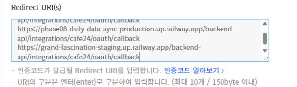
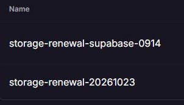

# 11 운영 전환·복구 준비서 — 2026-10-23, C7 배포 완료·원천 활성화 대기

**현재: C7 제품 배포·migration15개 적용 완료, 11 IN_PROGRESS / 12 NOT_STARTED.** 실제 readiness와 기존 업무의 읽기 smoke를 통과했고 누적 중단은 복구 포함 약12분29초다. 자동 수집·예약은 OFF이며 운영 원천 연결/보호 자격 배치·최초 하루 대조·원천 선택/활성화가 남아 있다. 현재는 [16절](#16-현재-실행-결과와-다음-환경-인계--1023-배포-후)과 [배포결과](11_배포결과.md)부터 읽는다. **1~15절은 당시 준비 근거이며 현재 승인·실행·일정 판정을 대신하지 않는다.**

**10/24 후속 관측:** [집 환경 재개 결과](11_집환경_재개결과_20261024.md)를 먼저 읽는다. 기존 Storage 정시3작업 성공/HEALTHY·10/30 만료 확인을 마쳤다. 정시 갱신으로 현재 배포 ID는 `f4585e3d-978a-42e5-bd9e-ed6f3d94cc66`으로 바뀌었고 같은 C7 image/release/startup fingerprint가 일치한다. 최초10/23 수동 대조는 아직 미실행이며 정상 관리자 API feature gate·실제 설정 키/allowlist·지원 운영 자격 binding 공백이 확인됐다. 아래10/24 시각이 미래라는 문구와 연결 준비 가능 추정은 당시 계획이며 최신 결과를 대체하지 않는다.

최신 요청은10/24 02:00 KST에10/23 하루를 수동 대조하는 것이다. 사용자가 cutoff도10/23으로 변경했고, Meta의 같은 날 CSV/API 충돌을 먼저 읽기 검토하도록 지시했다. 현재 그 범위의 current CSV/API 이력은0건이다. 실제 운영 policy를 변경하거나 자동 예약을 만들지 않았다. 제품 배포·migration 승인과 transaction 한정 owner 사용 승인은 이미 확인했으며 재요청하지 않는다.

현재 branch는 `codex/daily-data-automation-01`, 실행 시작 HEAD는 `665b65c8d9eb797e9aa38260f15fc2e464cb2004`, 이미지 전달 후 HEAD는 `cb13c6cabe91c70b21afa7907c6045b93f8e39f1`이다. 기존 수정/삭제는 앞선 Git 인계 commit에 보존했다. 고정 C7 release와 인계 Git commit은 구분하며 제품 재빌드/전체 회귀를 하지 않았다. 비밀·고객 원본·로컬 DB·세션/DPAPI는 Git에서 제외한다.

## 1. 새 증거와 읽기 범위

`E=C:/Users/seong/AppData/Local/MetaAdsPhase10Evaluation`

`N=E/continuation-20261022/operating-readonly-plan-20261023-v1`

`R=E/continuation-20261022/operating-readonly-resolution-20261023-v1` — 후속 READ ONLY 증거. N은 변경하지 않았다. N의 이전 문서 SHA `3ad7bc84ea924d5487e60c7f1b16822a4a990c10e84459b513e06235da56018f` 원문은 `R/preparation-before.md`에 보존했다.

`U=E/continuation-20261022/operating-user-decisions-20261023-v1` — 사용자 날짜·시각 선택 반영 증거. R의 문서 SHA `e8df1afe77e86ad062fe40ea0bcdfcaf9ad5c5958abe4b5024551e2d2a630d24` 원문은 `U/preparation-before.md`에 보존했다.

`V=E/continuation-20261022/operating-outage-comparison-20261023-v1` — 최대 중단1시간 결정 증거. 직전 문서 SHA `4a6b03d0fcdd9d54b9762d4c1e4fed389c39fb6bb7e90dac1eb0cc5effa3b9f2` 원문은 `V/preparation-before.md`에 보존했다.

`S=E/continuation-20261022/operating-portable-handoff-20261023-v1` — 이전 다른 환경 인계 준비 증거. 당시 문서 원문은 아래T의 `preparation-before.md`에 보존했다. S 및 이전N/R/U/V 증거는 수정하지 않았다.

`T=E/continuation-20261022/git-publication-20261023-v1` — 이전 Git 정리·commit/push 영수증. 원격과 commit `7abd371` 일치를 확인했다.

`Q=E/continuation-20261022/remaining-readonly-20261023-v1` — 직전 Meta 날짜·등록 조회·Storage 국소 진단·오프라인 이미지 확보/인계 증거. 해당 단계의 운영 변경·함수 호출·자격 변경은0회였다. Q와 이전 증거는 수정하지 않았다. 현재 승인 적용 결과/해시·Git 결과는 아래X의 index와 발행 영수증을 따른다.

`X=E/continuation-20261022/approved-callback-storage-diagnostics-20261023-v1` — 사용자 승인 원문 범위·전후 함수/body/secret digest/세job·Cafe24 저장 화면·버전5 단일 배포·현재 새 진단 로그0건·Git 인계 증거. callback 저장과진단 배포 두 변경만 수행했고 제품 배포·migration·자격/예약 변경·함수 수동 호출은0회다. 현재 준비서·H의 해시와commit/push 영수증은X를 따른다.

`Y=E/continuation-20261022/immediate-storage-readonly-check-20261023-v1` — 즉시 원인 확인 요청에 대한 읽기 전용 check1회·실행/로그 일치·공식 Railway 공지/문서와원인 판단·현재 Git 인계 증거. X와기존 증거는 수정하지 않았다. 현재 문서/H 해시와발행 영수증은Y를 따른다.

`Z=E/continuation-20261022/storage-project-token-repair-20261023-v1` — 별도 사용자 승인·단일 토큰 발급/범위 검증·정확 Edge secret1개 교체·check HEALTHY·버전6/동일 소스·동일 제품 배포ID/세job·Git 인계 증거. 기존Y/X 및 이전 증거는 수정하지 않았다. 현재 준비서/H 해시와Git 발행은Z 영수증을 따른다. 새 토큰은 원문 출력/공개 저장 없이 보호 전달했고 보호 파일은 Git 밖이다.

`AA=E/continuation-20261022/deployment-preparation-status-20261023-v1` — 현재 준비 완료/잔여 항목 정리. 기존 증거를 재사용한 문서 검토이며 새로운 운영·자격 변경/함수 호출/수집은0회다. 현재 준비서/H 해시와Git 발행은AA 영수증을 따른다.

`H=docs/daily-data-automation/records/11_환경이동_인계_20261023` — 저장소 안의 비밀값 없는 인계 요약·선별 검토 자료. **현재 manifest는 `H/transition-manifest.json`**, 재개 시작점은 `H/handoff-index.json`이다. Git 정리·commit·push는 최신 사용자 지시로 승인됐다. 이 파일들을 포함한 인계 commit은 새 환경에서 `git rev-parse HEAD`로 확인한다. 복사한 과거 계획 자료의 상대 날짜보다 현재 manifest가 우선한다.

최초 운영 관측은 2026-10-23 **10:09~10:24 KST**, 후속 관측은 각 영수증 시각을 따른다. N/R/Q 단계는 읽기만 수행했다. X 단계에서 승인된 Cafe24 callback 저장과 Supabase Edge Function 진단 소스 POST 배포만 예외로 추가했다. 계정·고객 행, 환경변수 전체, 인증 원문, 쿠키·브라우저 프로필·CDP는 출력/공개 저장하지 않았다. 앱 HTTP·provider 보고 조회·Storage/CDN 객체 검사·Edge 함수 수동 호출은 하지 않았다. 기존 cron·업무 DB·Vault·secret 값을 수정하지 않았다.

| 새 증거 | 입증 범위 |
| --- | --- |
| `railway-operating.json`, `operating-instance-identity.json` | 정확 project/environment/service, release/image, 현재 deployment 및 instance ID, 실행 설정 |
| `railway-source-settings.json`, `operating-route-target.json` | 연결 source·repo trigger·자동배포 경계, 실제 도메인, runtime target |
| `database-presence.json`, `database-catalog.json`, `migration-delta.json` | 운영 schema·37개 성공 이력·52개 후보의 실제 차이, 구조 지문·17개 새 표 |
| `database-runtime-permissions.json` | runtime 권한·NOLOGIN 역할·새 표 기본 권한 부재 |
| `management-config-backup.json`, `operating-boundary-credential.json` | Auth/Storage/DB boundary, 백업 가용성, Storage JWT의 만료 메타데이터 |
| `jobs-storage-metadata.json`, `renewal-recent-status.json`, `renewal-safe-reasons.json`, `renewal-function-metadata.json` | 기존 세 job의 시각·active·command 지문과 새 실패, 함수 version/ACTIVE |
| `business-highwater.json`, `current-pointer-metadata.json` | 현재 업무 writes의 집계 기준점과 CSV current 현황; 고객 행 0 |
| `candidate-binding.json`, `reused-evidence-refs.json` | C7과 운영형 Dockerfile/launcher의 관계, 재사용 근거의 파일·해시 |
| `cli-session-deviation.json` | 아래 CLI 세션 갱신 정황과 범위 이탈 기록 |
| `evidence-index.json`, `final-checks.json` | 새 증거·이 준비서의 해시, Git 보존 확인, 실행/미실행 범위 |

후속 R의 핵심 증거는 `renewal-log-window.json`, `renewal-last-success-route-log-status.json`, `renewal-outbound-route-log-status.json`, `renewal-component-boundary-corrected.json`, `storage-cause-assessment.json`, `derived-readiness-fingerprints.json`, `management-installation-principal-readonly.json`, `runtime-access-plan.json`, `migration-runner-plan.json`, `production-schedule-proposal.json`이다. `epoch-runtime-access.review.sql`과 `production-scheduler-install.review.sql`은 **로컬 검토용·미실행**이며 둘 다 ROLLBACK으로 끝난다. scheduler는 미생성 connection ID/anchor placeholder가 있어 그대로 실행할 수 없다.

**후속 세션의 자격 보존:** CLI 0회, 로그인/refresh/발급/폐기 0회, 운영 mutation 0회다. Railway 기존 token의 만료 여유를 먼저 검사하고 직접 query만 사용하며, 만료 임박/인증 거절이면 refresh 없이 중단한다. CLI 자격 파일의 SHA256·수정시각 전후 비교는 R의 최종 확인에 있다. 브라우저는 제공된 IAB/MCP Apps 두 surface의 관련 탭 유무만 제한 조회했고 Cafe24 탭은 없었다. 새 사이트 탐색·로그인·쿠키/프로필/CDP 추출은 하지 않았다.

**범위 이탈 1건:** 기존 Railway access token으로 query/me가 인증 거절된 뒤, 인증 확인용 `railway whoami --json`이 exit 0으로 끝났다. CLI config 갱신 시각은 `2026-10-23T01:10:35.4666013Z`이고 이후 직접 query는 성공했다. **CLI가 세션을 자동 refresh한 것으로 추론한다.** refresh endpoint 자체를 계측한 것은 아니지만, 이를 자격 변경 0으로 표시하지 않는다. 개인 whoami 응답과 config 원문은 저장하지 않았다. 이후 CLI를 호출하지 않았으며 소비된 Refresh/Deploy/Role-Execute helper는 실행하지 않았다. 운영 변수·공급자 자격 변경 명령은 실행하지 않았다.

## 2. 현재 운영 identity와 기존 근거 대비

| 항목 | 이번 READ ONLY 관측 | 기존 근거 대비·의미 |
| --- | --- | --- |
| Railway project / environment / service | `6fe72710-1fc8-445a-a77f-da2da8fee200` / `01ab3d5a-1036-45b0-aa9c-47179339c9be` / `b0835b08-7799-4c1c-8bcd-90746b9d4248` | 명세와 일치 |
| deployment / instance | `93d26b92-2ae3-4f7a-9444-f538059fb72c` / `ba5aa838-fdda-4df0-94b4-e3d8806683d3`; active deployment 1, replica 설정 1. 최초 SUCCESS, 후속 10:44 관측 SLEEPING | 같은 deployment의 serverless 상태 변화다. 앱을 깨우지 않았다. 현재 protected readiness·프로세스 메모리 fingerprint를 재측정한 것은 아님 |
| release / image | `9e9a1f82bb02346575565b031a43e17e13758dc8` / `sha256:d1f7d60715f74f72ffe872a43f860f769e78c7fb2fd0c6f185dd0f0bb22fd49a` | 10/19·20 운영 메타데이터와 일치 |
| runtime identity | `railway-production-01ab3d5a` / `bundle-loopback-api` | 새 target을 임의 발명하거나 `phase08-full-app`으로 치환하지 않음 |
| 도메인 | `patimagroup-work.com`, `grand-fascination-staging.up.railway.app` | 이름에 staging이 들어가도 **이 서비스는 운영**이다 |
| 기동 / 자원 | `setpriv --no-new-privs node deploy/launch-bundle.mjs`; sleep=true; CPU 1 / memory 1,000,000,000 bytes; ON_FAILURE / 10 | 기존 제한 보존. Prisma 3 / heavy concurrency 1 / PORT 8000 / API 4200 |
| 자동배포 | service source=null, repoTriggers=[]; Railway cron/nextCronRunAt=null | 연결 Git 자동배포 trigger 없음. 변수 변경에 의한 배포와 기존 Storage 갱신 배포 가능성까지 없다는 뜻은 아님 |
| Railway 전환 설정 | healthcheckPath/timeout, overlapSeconds, drainingSeconds=null; preDeployCommand=[] | 무중단·준비 완료 전 routing 보장을 현재 설정에서 추정하지 않음. 승인된 짧은 중단 경로 사용 |
| Supabase | 조직 `oqfvvptouenqglsibqsg`, project `iygjmosbelbosfxidqxv`, ACTIVE_HEALTHY, 서울 region | 기존 운영 Pro 사용량 산정 재사용. 새 사용량 조사·플랜 전환 없음 |
| DB boundary | `postgres/meta_ads`, `meta_ads_prod_runtime.iygjmosbelbosfxidqxv`, session pooler 5432, `sslmode=verify-full` | URL role·schema·Auth/Storage project 일치. 운영 URL을 개발 env에 주입하지 않음 |
| runtime 권한 | LOGIN / NOSUPERUSER / NOBYPASSRLS / connlimit 5; CONNECT·schema USAGE=true, CREATE=false | Prisma pool=3과 DB role 한도=5를 혼동하지 않음. migration/backup role은 NOLOGIN / limit 1 |
| schema | base table 54; columns MD5 `d304725068d362dc31ce85acfc3b91be`, constraints MD5 `31030b2a26195fe8f8ec84dec4953034` | 현재 지문이다. 과거 운영 catalog 전체가 없으므로 schema 전수 무변경을 주장하지 않음. 기존 백업표도 유지 |
| 자동 수집 상태 | source_connections/policies/credentials·sync_runs/leases·daily_data_sync_ops 미설치; feature/schedule 변수 없음 | 현재 정책·lease는 **미설치/N/A**. `lease=0`, READY 연결 또는 API primary 존재로 바꾸어 쓰지 않음 |
| Auth | runtime AUTH_PROVIDER=supabase; app/invite origin=`https://patimagroup-work.com`; Auth email=true, autoconfirm=false, JWT 3600초 | Auth redirect allow-list의 기존 다른 항목은 유지. template/로그인·기존 업무 전체 회귀는 반복하지 않음 |
| Storage | STORAGE_PROVIDER=supabase; `meta-ads-production` private; 제한 52,428,800 bytes | bucket metadata만 조회. 운영/격리 sentinel GET·CDN 재검사 없음 |

현재 업무 데이터는 개발 시작 당시 snapshot보다 뒤로 진행했다. Meta upload 146, Cafe24 upload 132, Coupang upload 239, security audit 1,634건이다. 최신 validate 시각은 각 `2026-10-22T23:59:38.278`, `2026-10-23T00:00:18.916`, `2026-10-23T00:16:00.882`; audit의 최신 createdAt은 `2026-10-23T01:11:17.421`이다. 이 값은 DB의 **timezone 없는 timestamp 원문**이며 KST로 임의 해석하지 않는다.

관측 당시 CSV current는 Meta 광고 12,121행 / 광고세트 4,518행 / Cafe24 36,012행이고 최대 실적일은 모두 10/22다. 10/22 current는 각각 102/14/233행이다. role backend 3개는 idle·transaction 없음이었다. 이 집계는 운영 정지나 동결을 증명하지 않는다. 실행 직전에는 최신 committed writes와 행별 before-image를 다시 결속해야 한다.

## 3. 실제로 발견한 Storage drift

기존 job은 다음 **3개 그대로 활성**이다. command 원문은 저장하지 않았으며 `commandMd5`와 job ID를 새 증거에 남겼다.

| job / ID | cron(GMT) | KST |
| --- | --- | --- |
| `storage-renewal-daily` / 1 | `0 19 * * *` | 매일 04:00 |
| `storage-renewal-verify` / 2 | `15 19 * * *` | 매일 04:15 |
| `storage-renewal-audit` / 3 | `20 19 * * *` | 매일 04:20 |

10/21 KST 04시대의 마지막 committed renew/check는 HTTP200·HEALTHY다. 그러나 **10/22와 10/23 KST의 세 실행씩은 failed**다. 최근 renew/check의 안전 오류는 `STORAGE_RENEWAL_FAILED_INSPECT_EDGE_AND_RAILWAY`, audit는 `STORAGE_RENEWAL_RUN_MISSING`. 진단 적용 전 함수는 version4 / ACTIVE / verify_jwt=false였다. 승인 적용 후 현재 함수는 아래 version5이며 verify_jwt=false와별도Bearer 검사는 유지했다.

운영 변수의 Storage JWT는 발급 10/19 04:00:01 KST, **만료 10/25 04:00:01 KST**다. 후속 READ ONLY에서 현재 공개 JWKS의 해당 kid 존재·ES256 서명·role/issuer/audience/subject·유효기간을 확인했다. 현재 active deployment의 생성 `2026-10-18T19:00:04.161Z`도 token iat `2026-10-18T19:00:01Z`보다 새롭다. **실제 Storage 요청·앱 readiness 성공은 이번에 확인하지 않았다.**

후속 로그로 확정한 실패 경계는 다음과 같다.

| 확인 | READ ONLY 결과와 한계 |
| --- | --- |
| 10/23 KST 04:00 / 04:15 실패 호출 | 동일 function ID·각 execution ID에 내부 오류 로그와 HTTP503이 결속된다. 함수 자체의 Bearer 거절 403과 다르다 |
| 같은 실행창 JWKS | 04:00:01.969 / 04:15:01.636 KST의 기록된 JWKS 요청은 200 |
| 마지막 정상 10/21 KST 창 | 함수 200/HEALTHY와 기록된 운영 Storage HEAD200이 보인다. 새 HEAD를 보낸 것은 아님 |
| 실패 10/23 KST 창 | 조회한 제한 구간에는 JWKS200 뒤 Storage HEAD 기록·운영 앱 로그가 없다. 따라서 **JWKS 이후, 첫 Storage probe 이전 분기가 유력**하나 로그 누락 가능성 때문에 부재만으로 분기를 확정하지 않음 |
| 보호 설정·배포 코드 | 세 필수 secret metadata가 존재하며 마지막 갱신은 모두 9/14. 함수 version4는 10/8 갱신이다. 배포 body GET으로 예상 kid·Project-Access-Token 경로·일반 오류 코드·403/503 분기 존재를 확인했고 인증값·source 원문은 저장하지 않음 |
| Railway project token | 정확 운영 환경에 storage-renewal label의 token metadata 1개가 남아 있다. 값은 마스킹돼 있으며 Edge secret digest와 실제 token의 일치는 증명하지 못함. 사용자 세션 query 성공을 Edge project-token 성공으로 대체하지 않음 |

**원인 판정:** 현재 토큰 만료·서명 불량, 호출 비밀의 단순 403, JWKS HTTP 실패로 설명하는 것은 새 근거와 맞지 않는다. 남은 유력 구간은 Edge의 Railway variables 읽기/접근 또는 그 앞뒤의 보호 key·token 검증이다. 특히 Railway 요청 오류는 배포 코드의 일반 catch에서 원문을 버린다. **정확한 내부 오류·당시 Railway 응답은 현 READ ONLY 자료로 특정할 수 없다.** 자동 refresh나 무조건적인 자격 교체를 수리안으로 확정하지 않는다. 기존 secret가 성공 이후 교체됐다는 증거도 없다.

로그는 폐기된 `logs.all`의 HTTP410 뒤 [현재 공식 logs API](https://supabase.com/docs/guides/observability/advanced-log-filtering)로 전환해 필요한 과거 실행창만 읽었다. 이 진단 경로 변경은 운영 함수 변경이 아니다. 후속 진단의 최초 deployment/iat 비교에는 PowerShell의 UTC kind 손실로 9시간 오차가 있었고, 보존된 ISO Z 값으로 오프라인 정정했다. **R의 `*-corrected.json`만 현재 판정에 사용**하며 최초 false 영수증은 이력으로 보존한다.

이 drift는 기존 Storage readiness/갱신 조건의 현재 차이다. 진단 직전 version4/body SHA `3666e566c74bce7e950254a60d37bb1945f77eb0e2b0b52e29f983c8d1fb2408` 일치를 확인한 뒤, **사용자가 승인한 진단 전용 소스5개를10/23 14:42:01 KST 한 번 배포했다.** API201·같은 함수ID·version5 ACTIVE·본문 SHA `8c5ab22747280acadca81b2adb3337024c9e20a50a64108200b150950d9d40aa`와진단 marker를 GET으로 확인했다. `H/storage-diagnostics-change.review.json`에 고정한 소스바이트 그대로이며 새로운 제품 빌드/검사는 반복하지 않았다. 고정 단계·Railway 작업·숫자HTTP status·허용 GraphQL code/reason만 기록하고 예외 원문/body/query/variables/headers/token은 기록하지 않는다. 세 필수 secret digest와세job의id/시각/active/command MD5는 전후 동일하고 verify_jwt=false·별도Bearer·공개403/400/503 동작의 소스도 유지했다. **진단은 수리가 아니다.** 배포 직후 조회창의 새 진단0건·후속cron0건은 아직 정상 증거가 아니다. 다음 기존 renew10/24 04:00, verify04:15, audit04:20 KST 결과를 읽어 원인 또는관측된 회복을 확인한다. 수동 renew/check·발급/refresh·변수 수정은 하지 않았다. 정확 원인 전 자격 교체를 추측하거나 제품 전환을 시작하지 않는다.

## 4. 고정 후보·migration delta·권한 변경표

C7 release `a49bec345f995ec71f25f9e569caa5fe20578235`, source `70a7c8cd00c2dd592f632dd35312e283011ef648c5926b5aac4273edb8cea6f2`, runtime 495 / migration 52를 고정한다. 후보 루트는 `E/candidate-20261020-v7`이다.

원 source manifest의 Dockerfile은 `deploy/cloud/phase08.Dockerfile`이다. 이것을 운영 launcher로 승계하지 않는다. **별도 운영형 `deploy/Dockerfile`** SHA256 `b5712e75aad69a719b2d62f855ddc83c355eb9ceac7fb50896f07e68523a578c`가 후보 영수증과 `E/portable-build-20261020-v3/result.json`에 일치한다. 그 영수증의 image ID는 `sha256:e3fb7eedf91ef64d6c26590856d2c979e5644b644109d4fb9549ad8ad66fa964`, linux/amd64, USER node, CMD `node deploy/launch-bundle.mjs`이며 C7 최종 binding과 일치한다. 06 callback 이미지 `ec7628ce…`와 다르다.

기존 image ID `sha256:e3fb7eedf91ef64d6c26590856d2c979e5644b644109d4fb9549ad8ad66fa964`는 Docker containerd 저장소의 **OCI index digest**임을 원본 바이트로 확인했다. Docker를 켜지 않고 보관 VHDX를 읽어 정확한 linux/amd64 manifest `sha256:8bce91f47b9a4b93a5b335b108ae43b94199b4469acd02499ae4ac18ee672bd0`와23개 blob·17개 layer를 복구했다. 모든 blob SHA와 비압축 diff ID가 일치한다. 전달 archive177,766,400바이트의 SHA는 `606b1ee90330dd990242f9ba8ffd92fd095ad8fb2a5dc11a9171ad148a2909b3`다. Docker daemon/컨테이너·WSL/디스크 mount·재빌드·pull·load·registry push는 하지 않았다. 원본 VHDX의 크기/수정시각은 그대로다. `H/image-artifact.json`에 원본 바이트 결속과 GitHub 미공개 초안의 asset668041912·서버 SHA 일치를 기록했다. registry의 실제 주소/digest 결속은 아직 실행 단계 출력이며 공개 release나 tag를 만들지 않았다.

**기동 계획값 `setpriv --no-new-privs node deploy/launch-bundle.mjs`는 유지한다.** 오프라인 최종 layer에서 실행 가능한 `usr/bin/setpriv`(ELF·mode0755·no-new-privs 지원 문자열)을 확인했다. 실제 앱 기동은 하지 않았다. 기존 운영 공개 설정에서 release만 C7으로 바꿀 때 expected fingerprint는 `f8b27a3b7d531a418c9df09c8a163b7903ff3dba0e11d8a53fc9bfd5a34f95e6`, 기존 release 계산값은 `d15e2bce0ef9662177979b846c276bcd47bf76739c8d2a53458894261ea09725`다. 이는 R의 고정 C7 projection 계산이며 새 HTTP attestation이 아니다. API/Web heap512/192MB·idle60,000ms를 유지하고 실제 설정이 바뀌면 같은 fingerprint라고 주장하지 않는다.

운영 성공 이력은 **37개**, 과거 rolled-back 이력 3행, 미해결 failed 행 0이다. 후보 52개에서 실제 pending은 **15개**다. 성공 baseline 중 36개 checksum이 정확히 일치한다. `20260710000000_add_coupang_manual_purchase_vat` 한 개는 후보 LF SHA `5a687637…`를 CRLF로 바꾸면 운영 SHA `5034e828…`와 정확히 일치한다. SQL 의미 차이로 보지 않으며 baseline SQL·이력 checksum·resolve를 변경하지 않는다.

| 순서 | pending migration | 핵심 영향 |
| --- | --- | --- |
| 1 | `20260929090000_common_sync_foundation` | 연결·암호화 자격·run/unit·policy/coverage/link·lease·Google/Cafe24 API 버전 표 |
| 2 | `20260929170000_canonical_import_origins` | 기존 CSV 표의 source/connection 경계, unique index 8개 교체·nullable 열 변경. 순수 표 추가로 표현하지 않음 |
| 3 | `20260930093000_meta_action_report_time` | Meta reporting time 의미 |
| 4 | `20260930130000_cafe24_oauth_attempts` | Cafe24 OAuth attempt 표 |
| 5 | `20260930131000_cafe24_requery_state` | Cafe24 sweep 상태 |
| 6 | `20260930160000_meta_nonadditive_reach` | Meta 비가산 reach |
| 7 | `20261001135600_cafe24_observed_revisions` | Cafe24 하루 관찰·revision |
| 8 | `20261002110000_cafe24_day_snapshot_fingerprints` | 보호 snapshot 지문 |
| 9 | `20261006110000_cafe24_provider_payment_inputs` | Cafe24 입력 출처·policy 검토 필드 |
| 10 | `20261007100000_cafe24_option_composition_514` | 옵션 구성 |
| 11 | `20261008143000_meta_conditional_metrics` | Meta 조건부 지표·nullable 의미; 구 Prisma의 API 행 해석 위험 |
| 12 | `20261008170000_meta_current_metadata` | 관찰 당시 자산 metadata |
| 13 | `20261012150000_meta_provider_purchase_value` | provider 구매값 |
| 14 | `20261012170000_scheduled_unit_checkpoints` | 주간 occurrence 내 제한된 단위 처리 |
| 15 | `20261020160000_cafe24_observation_epochs` | Cafe24 관찰 epoch 두 표. 과거 14개/51개 계획에 빠진 항목 |

각 SQL 경로·바이트 SHA256·대상 표·교체 index는 `N/migration-delta.json`에 있다. 새 표는 17개이므로 현재 catalog에 다른 변경이 없다면 base table은 54→71 예상이다. 격리의 70표/강제 RLS를 운영 기준으로 복제하지 않는다. 기존 `coupang_cost_rules_backup_20260723`도 보존한다.

| 변경군 | 계획하는 변경 | 보존·가드 |
| --- | --- | --- |
| schema | 위 15개만 순서대로 적용; 적용 이력 기록을 동일한 migration runner의 완료 경로와 결속 | 운영 migrate dev/db push/reset 금지. pending 판정·baseline 이력·SQL hash 불일치 시 중지. 성공한 중간 migration은 남기고 무작정 전체 재실행하지 않음 |
| 실행 권한 | **기존 Management `/database/query`의 postgres 주체**, exact 15개 per-file transaction과 신규 Prisma ledger 기록을 쓰는 명시 SQL 실행 계획 | `BEGIN READ ONLY`에서 postgres/on·schema DDL privilege를 확인했다. 실행하지 않음. migration role NOLOGIN 유지·운영 DB URL 로컬 주입 없음. 과거 public ledger용 maintenance runner/소비된 Role-Execute 재사용 금지. R의 `migration-runner-plan.json`이 순서·timeout·ledger 의미를 결속 |
| runtime grants/RLS | **15개 새 표는 고정 migration 자체가 기존 prod runtime/migration 역할에 CRUD·RLS 정책을 부여한다. 추가 보완은 epoch 두 표의 runtime SELECT/INSERT/UPDATE와 정책 6개만** | 현재 해당 staging 역할은 없음. 새 epoch 두 표의 FORCE RLS는 유지한다. 추가 DELETE·LOGIN·BYPASSRLS·전체 schema/default grant 없음. operation body SHA `64028eed0840228315b710106c5bf92696e9634aa6894f9828fb591a8a7ea1cd`; 검토용 SQL은 R에 있으며 미실행. 고정 migration의 기존 DELETE 권한을 없다고 쓰지 않으며 일괄 삭제를 승인하지 않음 |
| 배포·기동 | C7 운영형 image 바이트·운영 release/env를 결속, feature=false·schedule=false로 시작 | phase08 launcher·환경·target·자격 복제 금지. 운영 wrapper 최종값·registry digest·readiness fingerprint는 승인 전에 확정 |
| Auth/Storage/자원 | 현재 운영 Supabase·private bucket·origin·pool/heavy/sleep·자원 한도 유지 | 기존 Auth allow-list·Storage 세 job·자격 snapshot 전체 복원 금지 |
| 수집 설정 | 계정 allowlist·보호 refs·전용 machine secret·운영 schedule 정의를 새 운영 connection ID에 결속 | 새 연결은 기본 CSV/disabled. 권한·변수·자격 materialization은 이번에는 하지 않음 |
| 비용 | 기존 운영 Pro 및 10/21 산정 가정 유지 | 신규 유료 계층·Redis·상시 worker·새 DB·과금 변경 없음 |

## 5. 자격·계정·날짜 manifest

보호된 값 대신 위치/참조만 사용한다. production DB/환경에 아직 없는 credentialRef나 connection ID를 만들어 적지 않는다.

| 원천 | 승인 기준 계정·통화·시간대 | 기존 보호 근거·이번 한계 |
| --- | --- | --- |
| Google | `GOOGLE/1391592099/default`, KRW, Asia/Seoul | 현재 `%APPDATA%/gcloud/application_default_credentials.json`의 대체 ADC 및 기존 impersonation 경로에 대한 10/22 정상 영수증 재사용. 원 ADC 복원 금지. 짧은 access 발급/refresh와 새 Ads 조회는 이번에 미실행. 운영 materialization·credentialRef는 미배치 |
| Meta | `META/2138525300002203/default`, USD, Asia/Seoul | `C:/Users/seong/AppData/Local/MetaAdsMetaIsolated/mcp-access-token.dpapi`의 대체 SYSTEM_USER 소비자 영수증. 만료 metadata **2026-12-21 10:49:12 KST**, 당시 승인된 ads_read·ads_mcp_management·public_profile 범위 재사용. 운영은 검증된 transport 결정을 유지하며 임의 GRAPH 전환·새 권한 요구 없음. 이 로컬 DPAPI 파일은 운영 컨테이너의 ENCRYPTED_FILE envelope 자체가 아님 |
| Cafe24 | `CAFE24/didadi0729/shop1`, KRW, Asia/Seoul | 최신 ref `cafe06-runtime-refreshed-pair-20261023-v2`, revision13; access 만료 10/23 11:09:18 KST, refresh 만료 11/6 09:09:18 KST. secret ref `cafe-secret-actual-20261022-execution-v2`. 완료된 검증 재사용·refresh 미실행. 소비된 이전 local pair/helper 재사용 금지 |

Cafe24의 짧은 access 만료는 완료된 자격 처분을 되돌리는 이유가 아니다. 실제 실행 승인을 받은 시점에는 **그때의 최신 pair/revision/lease**로 운영 vault에 단일 refresh owner를 인계한다. 06은 Online·feature=false·connection disabled·READY 상태를 유지한다. 06 재중단·08 hold 해제·격리 runtime/IAM 복구는 포함하지 않는다. 동일 grant를 두 vault에서 독립 refresh하지 않는다. 단일 owner 인계를 할 수 없으면 새 수집을 열지 않는다.

사용자 본인 비밀번호 재확인 뒤 Cafe24의 **일일 데이터 자동화** 앱(공개 client ID `tVV6DZtPOFRlpPk1ex7ISA`)에서06/08 URI 두 개와운영URI 부재를 확인했다. 후속 사용자 승인으로 기존둘을 보존하고 **`https://grand-fascination-staging.up.railway.app/backend-api/integrations/cafe24/oauth/callback` 한 개만 추가 저장했다.** 저장 완료 알림과저장 후 세URI를 다시 읽었고 `H/cafe24-callback-saved.jpg`는 비밀값 없는 결과 화면이다. app URL·scope·secret·grant는 바꾸지 않았고 회원정보/비밀번호/client secret을 수집하거나OAuth 동의/토큰 교환/refresh를 진행하지 않았다. 고정C7의 향후 운영 설정은 `DAILY_SYNC_CAFE24_REDIRECT_URI`=그URI, `DAILY_SYNC_CAFE24_ISOLATED_ORIGIN`=`https://grand-fascination-staging.up.railway.app`, `DAILY_SYNC_CAFE24_RAILWAY_CALLBACK_ENABLED=true`다. 이번에 운영 변수를 적용하지 않았으며 이름에ISOLATED가 있어도08 기동/hold 해제를 뜻하지 않는다.

단일 manifest의 값 구분:

```json
{
  "execute": false,
  "approvalRef": null,
  "productionServiceId": "b0835b08-7799-4c1c-8bcd-90746b9d4248",
  "productionProjectRef": "iygjmosbelbosfxidqxv",
  "productionSchema": "meta_ads",
  "runtimeTargetId": "bundle-loopback-api",
  "deploymentEnvironmentId": "railway-production-01ab3d5a",
  "release": "a49bec345f995ec71f25f9e569caa5fe20578235",
  "candidateImageId": "sha256:e3fb7eedf91ef64d6c26590856d2c979e5644b644109d4fb9549ad8ad66fa964",
  "registryManifestDigest": null,
  "operatingStartCommand": "setpriv --no-new-privs node deploy/launch-bundle.mjs",
  "expectedReadinessFingerprint": "f8b27a3b7d531a418c9df09c8a163b7903ff3dba0e11d8a53fc9bfd5a34f95e6",
  "migrationExecutionPrincipalAndRunner": "postgres / existing Management database/query / exact 15 per-file transactions and new ledger rows",
  "runtimeGrantSqlSha256": "64028eed0840228315b710106c5bf92696e9634aa6894f9828fb591a8a7ea1cd",
  "maintenanceStartKst": "2026-10-25T02:00:00+09:00",
  "maintenanceLocalTimeKst": "02:00:00",
  "maintenanceLocalDateKst": "2026-10-25",
  "approvedOutageHardLimitMinutes": 60,
  "targetOutageMinutes": 10,
  "plannedRollbackStartByElapsedMinutes": 45,
  "plannedRecoveryReserveMinutes": 15,
  "requestedAutomaticModeDateKst": "2026-10-25",
  "requestedAutomaticModeDateIsFinalExecutionApproval": false,
  "productionConnectionIds": {
    "GOOGLE": null,
    "META": null,
    "CAFE24": null
  },
  "approvedCutoffLocalDay": {
    "GOOGLE": "2026-10-24",
    "META": "2026-10-24",
    "CAFE24": "2026-10-24"
  },
  "approvedManualVerificationDay": {
    "GOOGLE": "2026-10-24",
    "META": "2026-10-24",
    "CAFE24": "2026-10-24"
  },
  "weeklyAnchorAt": {
    "GOOGLE": "2026-11-01T03:05:00+09:00",
    "META": "2026-11-01T03:07:00+09:00"
  },
  "productionCredentialRefs": {
    "GOOGLE": null,
    "META": null,
    "CAFE24": null
  },
  "beforeImageProtectedRef": null,
  "storageDriftResolutionRef": null,
  "scheduleInstallSqlSha256": null,
  "scheduleReviewTemplateSha256": "acc51713d32fb5ef54360726430d048174be75bde199cee65e0f11ed4be580f3",
  "proposedJobCount": 77,
  "datePolicyApproved": true,
  "plannedComparisonStartKst": "2026-10-25T02:00:00+09:00",
  "plannedAutomaticModeDateKst": "2026-10-25",
  "plannedFirstDailyOccurrenceKst": "2026-10-26T02:00:00+09:00",
  "datePolicyApprovedByProvider": {
    "GOOGLE": true,
    "META": true,
    "CAFE24": true
  },
  "ociIndexDigest": "sha256:e3fb7eedf91ef64d6c26590856d2c979e5644b644109d4fb9549ad8ad66fa964",
  "linuxAmd64ManifestDigest": "sha256:8bce91f47b9a4b93a5b335b108ae43b94199b4469acd02499ae4ac18ee672bd0",
  "candidateSetprivFilesystemVerified": true,
  "imageArtifactRef": "image-artifact.json"
}
```

사용자는 **2026-10-25 02:00 KST에 Cafe24·Google·Meta의10/24 하루치를 대조하고 정상 확인 뒤 자동 전환하는 일정**과 **복구 포함 중단60분**을 정했다. Meta는 명시한 첫 하루를 포함하는 최소 원천 경계10/24로 계획에 결속하며 이전 날짜의 API 전환/수집을 추가하지 않는다. 이 시각은 작업창 시작 목표이며 실제 대조는 필요한 배포·readiness·CSV 준비 뒤 순서대로 수행한다. 정각 완료나 provider 수치의 최종 확정을 보장하지 않는다. 현재 manifest는 `H/transition-manifest.json`이다. 날짜 정책이 정해졌어도 `execute=false`, `approvalRef=null`이며 **실제 운영 실행은 계속 금지다.**

남은 null을 본인 결정으로 다시 묻지 않는다. 세 원천 최초 하루10/24·작업창10/25 02:00·60분 한도는 결속했다. production connection ID·보호 envelope/ref·registry 최종 주소/digest·after-drain before-image·실측 readiness·바인딩 SQL hash는 제품 실행 승인 뒤의 생성/검증 출력이다. 현재 존재하지 않는 ID·secret을 만들거나08 값·개발 시작 snapshot을 복사하지 않는다. before-image는 pause/drain 뒤 변경 전에 최신 사용자/CSV writes·actor·행버전·정책/current/link/coverage의 완전한 키로 결속하고 public evidence에는 참조·해시·행수만 남긴다. callback/진단 배포와14절의 좁은 Storage 자격 수리는 승인 적용을 마쳤다. 기존 자동 갱신 결과는 후속 읽기 대상이며,9절 제품 전환은 별도 승인 범위다. 기술적 값을 사용자에게 생성/전달하라고 요구하지 않는다.

날짜 선택 규칙은 미리 고정한다. 계정별 승인 cutoff `C_p`는 계정 현지 날짜 00:00다. `d<C_p`는 기존 CSV이고, `d>=C_p`도 성공 coverage·정책·current/version/link가 확인된 날짜만 API로 선택한다. 과거 날짜를 조용히 API로 바꾸지 않는다. 수동 최초 대조 `S_p`는 완료된 하루만 명시하며, Meta 최초 verify는 `verificationDay=fromDate` 제약을 지킨다. CSV가 이미 있는 날은 현재 CSV를 shadow 보존하고 해당 입력 차이와 원천 선택을 명시 승인한다. Cafe24는 성공한 **하루 단위** activation만 허용하고 cutoff 이후 전체를 미리 API 정책으로 덮지 않는다.

이번 선택으로 Cafe24·Google의 경계는 **2026-10-24 00:00 KST**다. Cafe24는 실적일10/23까지 기존 CSV를 유지하고 Google에 없는 CSV를 만들어 채우지 않는다. 두 원천은 **10/24부터** 성공·대조·정책 확정된 날짜만 API 선택 대상이다. **최초 대조 대상 실적일10/24를 확정했다.** 그 하루가 끝난10/25 00:00 KST 이후 자료를 준비하며 계획 작업창은10/25 02:00부터다. 날짜 선택은 수집·발행·예약 실행 승인이 아니다.

**실적일과 대조 실행일을 구분한다.** 10/24 하루치를10/25 작업창에 대조한다. 그때24일 CSV·별도 실행 승인·기존 readiness 조건이 갖춰져야 한다. 사용자는10/24부터 다른 환경에서 이어가므로 이 로컬 세션에 미래 실행이나 예약을 맡기지 않는다. 10/24에23일 자료를 추가 대조·수집하는 작업은 이 계획에 넣지 않는다.

Cafe24는 같은 **10/24 실적일**의 수동 CSV를 정상 경로로 입력하고, API 하루를 CSV primary 아래 shadow로 보관·비교한 다음 성공한 하루만 선택 전환한다. 두 입력이 같은 순간에 실행될 필요는 없으며 전건 입력과 before-image를 안정화한 뒤 순서대로 처리한다. 두 결과를 합산하거나 두 writer가 업무 current를 동시에 덮도록 하지 않는다. **Google은 기존 CSV 업로드가 없는 입력 계약**이므로 수동 업로드를 새 필수 단계로 만들지 않고 같은 계정/날짜·모든 페이지·계정 합계로 API를 검증한다. Google Ads 화면을 대조 자료로 쓰더라도 새 CSV 업로드 기능을 뜻하지 않는다.

25일에 대조·원천 선택을 마쳐 자동 모드를 연다는 계획은25일 실적이 이미 갱신돼 있다는 뜻이 아니다. 기존 주기는 **Cafe24 매일 완료 전일 하루, Google·Meta 7일마다 완료7일**이다. Cafe24/Google 최초 하루10/24 다음 자동 대상은 아래 일정으로 결속했다. 25일이 됐다는 이유로 새 수집을 자동 승인하거나 Google을 매일 조회하지 않는다.

Cafe24 첫 예약은 승인된 02:00 KST occurrence의 전일 하루다. Google·Meta 첫 주간 anchor `A_p`의 대상은 `localDate(A_p)-7`부터 `-1`까지 각 날짜 한 번이다. 처음 수동 승인한 날과 이미 수집한 날을 주간 창에 중복시키지 않도록 anchor/cutoff를 함께 결정한다. 부분 overlap을 임의로 잘라 다른 범위로 요청하지 않는다. 7일 간격·기존 unit/retry/deadline을 그대로 쓰며 자동 backfill·최근 주 반복 보정·월 보정은 없다. 미수집 날짜는 NOT_COLLECTED/누락 경고로 보인다.

예약의 구현 규칙은 읽기로 확인했다. 기존 `jobPlan`은 Cafe24 window 안에 1분 간격 step, Google/Meta는 5분 간격 step을 두고, 각 window+3분에 audit 한 개를 둔다. step은 같은 occurrence의 다음 단위/제한 retry이며 새 과거 범위를 조회하는 trigger가 아니다. 주간 비해당 날짜는 management slot에서 막고 provider를 호출하지 않는다. 기존 installer는 08 ref·68 FORCE RLS 표·고정 연결 ID·Storage ops **부재**를 요구하므로 운영에 그대로 실행하면 안 된다. 이것은 새 gate가 아니라 실제 installer target 불일치다. 운영용 guard·origin·target·Vault ref를 분리한 미실행 검토 template를 R에 준비했다.

현재 **77개 job 계획**의 실제 등록·활성화는 미승인이다. 세 원천의 최초 하루가 모두10/24가 되므로, Google·Meta의 첫 주간 범위는 둘 다10/25~31이다. 이전의 다른 요일/Meta 하루 이른 cutoff 제안은 폐기하고 **같은 첫 주간 날짜의 분 단위 엇갈림**으로 계획했다. 현재 정의는 `H/production-schedule-plan-v2.json`이며 기존 `production-schedule-proposal.json`은 과거 근거다. Cafe24 window60분·주간35분·1/5분 step·단위 예산을 바꾸지 않는다.

| 원천 | 계획 KST window·audit | job 이름·개수 | 선택한 cutoff·최초 대조일과 뒤따르는 자동 대상 |
| --- | --- | --- | --- |
| Cafe24 | 02:00~03:00, audit03:03. 정상 완료 목표02:30 유지, 나머지는 기존 제한 복구용 | `daily-data-sync-prod-cafe24-0`~`-59`, `-audit`: 61개 | **C=S=10/24 선택 완료**. 10/25 작업창에 대조 후 정상 시 활성화, 첫 자동10/26 02:00 대상10/25 |
| Google | 03:05~03:40, audit03:43 | `daily-data-sync-prod-google-0`~`-6`, `-audit`: 8개 | **C=S=10/24 선택 완료**. 10/25 작업창에 검증 후 정상 시 활성화, 첫 주간11/1 03:05 대상10/25~10/31 |
| Meta | 03:07~03:42, audit03:45; Google보다2분 뒤 | `daily-data-sync-prod-meta-0`~`-6`, `-audit`: 8개 | **C=S=10/24 계획 결속**. 10/25 창에서 대조, 첫 주간11/1 03:07 대상10/25~10/31 |

각 주간 첫 창은 수동 하루10/24 다음 날부터 시작해 중복 없이10/25~31을 읽는다. 코드상 step은 `maxUnits=1`, Google55초·Meta65초 예산이다. Google03:05/10/15…와Meta03:07/12/17…의 계획상 최소 여유는65초이며 실제 요청 지연이 생기면 기존 heavy1·fence·동일 occurrence 제한 retry/누락 경고로 처리한다. 외부 지연이 절대 없다고 보장하지 않고 과거 범위를 추가하지 않는다. 정규시간·주기·77 job·예산의 순수 계획 검증만 수행했고 provider 호출은0회다. 실제 runtime 정의의 anchor는 UTC ISO Z로 정규화하고 새 connection IDs 결속 뒤 정확4개 키만 직렬화한다. 마지막 audit03:45는Storage04:00/15/20과 분리된다. p95≤5초·Prisma3·heavy1과 기존 복구 한도를 유지한다.

## 6. 승인 이후의 전환 순서와 시간 한도

아래는 **미실행 절차**다. 번호를 체크하거나 실제 결과로 바꾸지 않는다. 사전 준비 중에는 기존 앱을 계속 제공한다. **중단시간은 사용자의 조회·업로드를 처음 제한한 순간부터 정상 업무를 다시 제공할 때까지**이며 pause의 실제 접근 제한·drain·migration·기동·readiness·필요 복구를 모두 포함한다. drain 완료 뒤부터 시간을 세지 않는다.

1. **실행 직전 결속:** 사용자 결정과 별도 final approvalRef를 확인한다. 읽기 한계를 해소하고, 아직 생성되지 않은 출력값은 해당 실행 단계에서 생성·검증할 위치를 명시한다. 정확 운영 identity·직전 release/image·schema/migration delta·새 Storage 상태·job command 지문을 읽기로 대조한다. 승인 뒤 drift가 생기면 그 영향만 다시 검토한다. 기존 10 검증·전체 회귀를 반복하지 않는다. 04:00~04:20 기존 갱신 작업과 겹치는 전환창을 선택하지 않는다. 배포/image 전달·보호 envelope·runner 준비는 업무 중단 전에 끝낸다.
2. **pause:** 전용 자동화 예약은 최초에는 미설치 상태로 유지한다. 이미 설치된 재시도 상황이면 이번 manifest의 전용 job만 pause하고 feature/schedule OFF·connection disabled를 확인한다. Storage 예약·06·08에는 손대지 않는다. 본인 업로드를 승인된 짧은 창 동안 멈추고 운영 앱의 새 요청 진입을 차단할 구체적 정지 경로를 확정한다. **실제 업무 접근을 처음 제한하는 즉시 중단 타이머를 시작한다.** 존재하지 않는 maintenance flag를 가정하지 않는다.
3. **drain/fence·before-image:** 중단 타이머를 계속 계측하며 기존 HTTP/DB 작업의 종료·commit/rollback을 확인한다. 기존 앱에는 sync lease가 없으므로 사업 트랜잭션 drain을 lease0으로 대체하지 않는다. 새 앱 재시도라면 run/refresh owner 종료·lease generation fence를 확인한다. fencing 확인 없이 수동으로 lease만 지우지 않는다. 최신 CSV/user writes·audit와 policy/current/link/coverage의 보호 before-image를 결속한다. **제안 2분** 내 안전 drain을 증명하지 못하면 전환을 중지한다.
4. **migration·권한:** 기존 Management postgres 주체의 exact 15개 per-file transaction을 계획한다. `search_path=meta_ads,pg_catalog,extensions`, `lock_timeout=2s`, `statement_timeout=30s`와 scoped lock 아래 baseline/prefix·checksum을 확인하고 해당 SQL·신규 Prisma ledger 한 행을 함께 commit한다. 실패한 file은 ledger도 함께 rollback하며, 과거37개의 이력을 rewrite/resolve하지 않는다. 고정15개가 포함한 권한을 확인한 뒤 epoch 두 표에만 별도 runtime SIU/RLS 보완을 적용한다. 이것은 검토된 실행 **계획**이며 기존 운영에서 실행·검증한 custom runner라고 주장하지 않는다. lock 실패/부분 적용은 성공 범위와 실패 transaction을 구분하고 중지한다. 아직 API 이력이 없다면 구 앱 CSV 호환 경로를 유지할 수 있지만 DDL을 역삭제하지 않는다. 14개 합성 DDL 합계 약 165ms는 로컬 관측이며 운영 소요·15번째 소요의 보장이 아니다.
5. **후보 readiness:** 동일 C7 image와 운영 Auth/Storage/DB boundary, release SHA 및 feature=false·schedule=false·빈 예약 정의로 기동한다. 보호 `GET /backend-api/health/ready`의 release와 **승인된 운영 config fingerprint**를 대조한다. launcher 내부 readiness는 `127.0.0.1:4200/api/health/ready`다. Railway SUCCESS나 공개 live 200만으로 통과시키지 않는다. **제안 기동 예산 5분**. 오대상·fingerprint 차이·Storage 실패면 수집을 열지 않는다.
6. **업무 재개:** 현재 로그인/CSV 조회/쿠팡 조회/KPI/기존 Storage에 대한 필요한 비파괴 smoke만 한다. 가짜 업무 데이터를 쓰지 않고 기존 전체 회귀를 요구하지 않는다. **사용자가 정한 hard limit는 복구 포함 60분**이며 목표10분은 유지한다. 실제 접근 제한 시점부터 계측하고, 계획상 **늦어도 경과45분에 전환 시도를 중지해 복구15분을 남긴다**. 오류·fence/readiness 실패는 45분까지 기다리지 않고 즉시 중지한다. 실제 중단을02:00에 시작한다면 복구 착수 한계02:45·업무 복구 한계03:00이다. 45/15분 배분과 목표10분은 계획값이며 운영 실측·복구 성공 보장이 아니다. provider/run/transaction/lease별 기존 제한을 60분으로 늘리지 않는다. 복구도 실패하면 한도를 지키려고 불안전 구 앱/DB 복원을 강행하지 않고 중단 상태·원인·실제 시간을 알린다.
7. **자격·원천 활성화:** 업무를 재개한 새 앱에서 전용 예약은 계속 OFF로 둔다. 보호 refs·계정 metadata·당시 유효 자격·단일 refresh owner를 연결한다. 관리자 정상 bind/verify 경로를 사용하고 직접 READY seed로 우회하지 않는다. Google/Meta는 명시한 완료 하루, Cafe24는 snapshot과 승인 입력 출처를 써서 shadow→검토→하루 활성화한다. 네트워크 fetch 중 DB transaction을 잡지 않는다. 해당 scope의 policy version·lease generation·current/link/coverage와 감사가 원자적으로 결속되어야 한다.
8. **한정 운영 적재·정책:** 세 원천 각각 승인한 하루만 공통 수집 경로로 대조하고 성공 여부를 분리 기록한다. API/CSV current를 더하지 않고 Meta 광고/광고세트 비용도 합산하지 않는다. Cafe24는 `CSV_REVIEWED`/`API_ONLY`, null/차이·캐시 경고 계약을 유지한다. 한 source 실패를 숨겨 전체 완료로 처리하지 않는다. 이 적재 시간은 위 UI 중단시간과 분리 측정한다.
9. **전용 예약 활성화:** 세 원천·원천 정책·UI가 정상일 때에만 확정한 운영 scheduler 정의·narrow machine guard·replay key·target을 결속해 전용 job을 설치/활성화한다. 임시 Cron을 잠깐 켰다가 끄는 시험은 하지 않는다. 인증 거부 확인에는 provider 쓰기를 유발하지 않는 경로를 사용하고 정상 호출은 승인된 실제 occurrence만 쓴다. 미래 정시 실행을 지금 앞당기지 않는다. 기존 Storage 세 job과 다른 예약의 count/command/시각은 그대로인지 대조한다.
10. **인계:** 실행 manifest에 실제 image/registry digest·schema·config fingerprint·시각·각 source/day/run·job·비용 변화·smoke·복구 여부를 남긴다. 11의 완료 조건을 통과해도 `DEPLOYED_PENDING_OBSERVATION`이며 프로젝트 전체 완료는 아니다. **12 정시 관측은 별도 범위**로 남기고 이번 준비나 마지막 승인 요청에 끼워 넣지 않는다.

## 7. 실패 복구: 선택 CAS와 새 앱 CSV fallback

첫 조치는 전용 예약 pause/kill switch → in-flight publish/refresh drain 또는 generation fence다. 최신 정책·current·사용자 writes를 읽기 전에 과거 snapshot으로 복원하지 않는다.

| 실패 지점 | 복구 순서 | 금지·보존 |
| --- | --- | --- |
| migration 전 | 후보/설정 변경을 시작하지 않거나, 변경했다면 이번 scope만 철회하고 기존 release/config 유지 | 옛 자격 snapshot 복원 금지 |
| 일부 DDL 후·API 적재 전 | 실패 transaction rollback 여부·성공 migration 이력 확인 → 새 표/열 유지 → 구 앱 복귀 readiness 판정 → 통과한 경우에만 현재 정상 운영 이미지 사용 | migration 이력 지우기·down/reset·schema 전체 복구 금지. 아직 API history가 정말 없는지 전역 확인 |
| 새 앱 readiness 실패·API 이력 없음 | 새 writer 정지/fence → 현재 안전 config와 기존 image 경로 검토 → 구 앱 gate를 통과하면 한정 복귀, 아니면 중단 유지 | SUCCESS metadata만으로 routing 재개 금지 |
| 하나 이상 API 발행 후 | 아래 manifest 선택 CAS → 새 앱 feature OFF·정책 CSV projection → 한정 업무 smoke | 새 표·Google 자료·run/audit/API current/history 행을 삭제하지 않음. CSV가 없는 날짜는 NOT_COLLECTED |
| CAS 충돌·후속 사용자 변경 발견 | 해당 키/정책을 덮지 않고 충돌 기록 → 최신 정상 user/CSV 선택을 보존 → 새 앱에서 scope를 좁혀 재검토 | 전체 policy/connection/day 일괄 덮기·과거 before-pointer 강제 복원 금지 |
| 자격 문제 | 새 수집 중단·최근 성공 데이터 유지·유효한 현재 보호 ref만 사용; 본인 동의가 실제 필요해진 경우만 요청 | 노출·폐기·소비된 자격 복원/refresh helper 재실행 금지 |

선택 CAS의 단위는 **운영 connection × kind × 현지 날짜 × manifest의 완전한 business-key 집합**이다. Meta 광고/광고세트와 link·coverage를 함께 다루며 Google/Cafe24도 실제 writer의 before/after 전체 투영을 사용한다. manifest의 expected-after row/version/link/정책 버전·lease generation이 현재와 같을 때만 이번 전환이 만든 pointer/정책을 되돌린다. PK만 맞거나 `isCurrent`만 맞는 CAS는 부족하다. 최신 CSV NEW_VERSION·다른 정상 source·상품/매칭 수정·후속 audit는 범위 밖이므로 보존한다. 성공 복구도 새 audit 이벤트로 남기고 기존 이력을 고치지 않는다. 네트워크 작업은 transaction 밖, 검증과 선택 변경은 짧은 transaction 안에서 한다.

구37 이미지 gate는 정책만 CSV로 바꿨다고 통과하지 않는다. 정지/예약 pause·enabled connection 0·live lease 0·running run 0·manifest scope의 API policy 0·**전체 API current 및 history 0**을 현재 코드의 `inspectOldAppRollbackReadiness`로 판정한다. API history 하나라도 남으면 **`API_HISTORY_REMAINS`로 차단**한다. history를 삭제해 통과시키지 않는다. 따라서 최초 실제 API 발행 뒤 정상 기본 복구는 **검증된 새 앱의 CSV 논리 fallback**이다.

재사용한 `E/api-20261020-rollback-v12/result.json`은 로컬 합성 PostgreSQL에서 후속 CSV/user writes 보존·stale CAS 거절·새 앱 CSV fallback·구 앱 history 차단을 입증했다. 이는 운영에서 복구를 실행한 증거가 아니다. 오래된 generated helper의 “history 유지한 구 앱 복귀 가능” 설명은 현재 gate와 충돌하므로 사용하지 않는다.

Supabase는 최근 7개 COMPLETED physical backup metadata를 반환했고 PITR=false다. 최신 backup 시각은 10/23 02:55:27.747 KST이다. 백업 가용 metadata와 실제 restore 성공을 구분한다. **전체 DB snapshot 복원은 이 전환의 일반 복구 경로가 아니며**, backup 이후 사용자/CSV/감사 writes를 잃는 복구를 승인하지 않는다. Storage 원본까지 DB backup이 복원한다고 가정하지 않는다.

## 8. 중지 기준·읽기 한계·실행 출력값

중지 기준은 기존 계약의 실제 적용이다: target/release/image/schema delta 불일치, drain/fence 미확인, 만료/계정·통화·시간대 불일치, lease/policy CAS 충돌, incomplete page/coverage/link, readiness mismatch, p95>5초 또는 실제 오류·OOM, Storage 새 실패/여유 부족, 승인 중단한도 접근, 예상 밖 비용/권한/배포 발생. 영향 있는 scope를 멈추고 마지막 성공을 보존한다. 전체 회귀·예약 날짜 재대기·영구 Meta 토큰·별도 MCP 무료 선언·정확 sentinel CDN 성공을 추가 조건으로 삼지 않는다.

| 분류 | 값·범위 | 현재 판정 |
| --- | --- | --- |
| 읽기로 확정한 사실 | 현재 public config·heap/idle, 기존 Management postgres 주체·권한, 고정 migration의 GRANT/RLS, scheduler의 step/audit 생성 규칙 | 새 증거로 결속 완료. migration role LOGIN 변경이나 임의 17표 blanket GRANT가 필요하다고 묻지 않음 |
| 완성한 계획값 | 기존 기동 명령 보존, expected fingerprint, per-file migration/ledger 계획, epoch2표 SIU+6policy SQL/body hash, 77개 job 제안·운영 전용 설치 template | 모두 미실행. template hash와 실제 IDs/anchor를 바인딩한 최종 실행 hash를 구분 |
| 현재 Storage 상태 | 별도 승인한 갱신용 Project Token1개와Edge secret1개 교체 뒤 check200/HEALTHY/readinessVerified=true | 함수metadata6은secret반영 결과이며소스본문은version5와동일. 실제renew·Storage JWT발급·제품재배포는미실행.14절이현재결과 |
| 이미지 확보 완료 | 정확 OCI index·amd64 manifest·23 blob/17 layer·setpriv와177MB archive·GitHub 초안 asset 확인 | 오프라인 읽기로 해결. Docker/WSL/컨테이너 실행·재빌드·registry 게시 없음 |
| callback 추가 완료 | 정확 운영URI 하나를추가하고기존06/08 URI 보존·총3개 저장 재조회 | OAuth 동의/자격/운영 변수 변경 없음. 재실행 금지 |
| 실행 때 생길 출력 | production connection IDs·credential envelope/ref·registry manifest digest·after-drain before-image·실측 readiness·바인딩 SQL hash | 현재 존재한다고 꾸미지 않으며 사용자에게 값을 생성/전달하라고 요구하지 않음. 승인 이후 해당 단계에서 보호 경로로 생성·결속 |
| 날짜 결정 완료 | 세 원천 첫 하루10/24·10/25 02:00·복구 포함60분·주간 엇갈림 계획 결속 | 날짜를 다시 묻지 않음. 제품 실행 승인 범위는9절, 현재 완료/잔여 정리는15절 |

**지금 본인 로그인/MFA나 비밀값 전달을 요청하지 않는다.** 보이지 않는 브라우저 세션을 추출하거나 새 로그인으로 읽기 한계를 우회하지 않는다. 이후 허용된 범위에서 실제 본인 인증 화면이 나타날 때만 그 로그인/MFA/OAuth 동의를 최소 단위로 요청한다. 계정·소비자 전수 열거와 Pro/Free 선택은 다시 묻지 않는다. 실제 승인된 전환창에는 본인 업로드를 잠시 멈추는 협조만 필요하다.

## 9. 제품 전환의 최종 운영 승인 범위 — 아직 실행 승인 없음

최종 제품 전환은 여전히 미승인이다. 사용자 별도 승인으로 callback 추가·진단 소스 배포·14절 Storage 갱신용 Project Token 한 개와Edge secret 교체/check HEALTHY를 완료했다. 실제 자동 JWT 갱신은 기존 다음 정시 결과에서 후속 확인하며 제품 배포·migration·수집·자동화 전환은 별도 최종 승인 범위다. 실행 출력의 생성/검증 방법은 아래와 같다.

- 위 정확 운영 identity에 C7 동일 image를 전달·배포하고, 승인된 launcher/운영 config·좁은 credential materialization·machine 인증을 연결하는 변경.
- exact 15개 migration과 그 자체의 권한 변화, 확인한 Management postgres 주체·per-file ledger 계획, 별도 epoch2표 runtime SIU/RLS 보완 SQL, 보호 before-image 생성과 승인한 최대 중단시간 내 정지/drain/fence·readiness·필요 smoke.
- 명시한 세 계정의 완료 하루·cutoff별 원천 선택/한정 수집, 성공 후 확정한 전용 일정만 설치·활성화. 날짜·주간 anchor·job 집합이 null이면 그 단계는 승인되지 않는다.
- 실패 시 이 문서의 선택 CAS·새 앱 CSV fallback. 구37 이미지는 전역 gate 통과 시에만 가능하고 API history가 남으면 금지.
- Storage 갱신용 Project Token 발급1개와정확 Edge secret 교체/check는14절의 별도 승인으로 완료했다. 이 승인을 다른 자격·IAM/과금·제품 변경으로 확대하지 않는다. 기존 세job과다른secrets·app scopes·06/08 URI는 유지했다.

운영 Pro·Storage 세 job·06 Online/disabled·08 hold·`railway-06` PAUSED·정확20바이트 sentinel EXCLUDED_LIMITATION은 유지한다. 12 관측·자동화 재개·새 과거/월 수집·외부 메시지·공급자 자격의 임의 발급/refresh/폐기·Git reset/stash/clean은 범위 밖이다. **현재 브랜치의 선별 Git 정리·commit/push만 최신 사용자 지시로 별도 승인됐다.** Git 발행을 제품 배포/migration/운영 변수/IAM/예약/과금 변경·새 수집·11/12 실행 승인으로 확대하지 않는다. 과거 CLI 세션 자동 갱신 정황은1절의 별도 예외로 보존한다.

현재 완료/잔여는15절과 `H/deployment-preparation-status.json`을 따른다. 먼저 다른 환경의 Git/정확 이미지/보호 접근을 확인하고, 필요하면 기존 정시 Storage 갱신 결과만 읽는다. 운영 중지·복구 명령과최종 실행본/출력은 승인 범위 안에서 결속하며 실제 전환은9절 최종 승인 전 수행하지 않는다. 완료된 callback/진단 배포/토큰 발급/secret 교체/check와전체 검증은 반복하지 않는다. 현재 문서/H·Git 결속은 아래AA의index와발행 영수증을 따른다.

## 10. 선택한 날짜와 준비 결과 — 실제 실행 승인 아님

세 원천 모두 **10/24 하루치**를 **10/25 02:00 KST 작업창**에서 대조하고 정상 확인 뒤 전환한다. cutoff는 첫 API 하루만 포함하는 최소 경계10/24로 계획 결속하며 이전 날짜는 추가하지 않는다. 최대 업무 중단은복구 포함60분, 계획 복구 착수는늦어도45분이며 오류 시 앞당긴다. Cafe24 첫 자동10/26 02:00 대상10/25, Google·Meta 첫 주간은11/1 03:05/03:07 대상10/25~31이다. 원천/화폐/시간대·정상0/미수집 구분·후속 사용자 writes/감사/API history 보존은 그대로다.

남은 날짜 질문은 없다. 정확이미지인계·callback추가·진단소스배포·Storage갱신용ProjectToken한개와Edge secret교체·check정상을확인했다.현재Storage결과는14절이고과거예외소실/variables조회실패기록은이력으로보존한다. 제품배포·migration·원천수집·자동전환은계속미승인이다.


## 11. 10/24 다른 환경 재개와 Git 업로드 전 분류

사용자는10/24부터 이 로컬이 아닌 환경에서 이어간다. 이 세션에 미래 실행을 맡기거나 자동화를 만들지 않는다. **필요 코드·migration·문서·인계 자료 보존, 불필요 임시 산출물 정리, 현재 `codex/daily-data-automation-01` 브랜치 commit/push를 명시 승인했다.** 비밀값·고객 데이터·로컬 DB는 Git에서 제외하며 기존 기능 변경과 삭제240개를 유지한다. 시작 HEAD `9e9a1f82bb02346575565b031a43e17e13758dc8`는 인계 commit의 기준이며 C7 고정 후보와 동일 소스라는 증명은 아니다.

이번 파일명 중심 조사에서 미추적 최상위61항목 안 실제 파일은 **1,244개**였다(새H 인계 파일 생성 전). 그중 `scripts/cloud` 918개·`apps/api` 113개·문서58개이며 업무 보고서도 섞여 있다. staged0·기존 수정82·삭제240을 보존했다. 240개 기존 삭제를 임시파일 청소로 새로 분류하거나 복원하지 않는다. 전체 제품 소스·보고서 내용·로컬 DB·전체 로그를 읽지 않았다.

| 분류 | 이번 확인과 처리 방침 |
| --- | --- |
| 필요한 변경 | 새 기능 소스·정확15개 migration·운영 Dockerfile/launcher·계약/준비서·구글 원본 계획 보존. 미추적이라는 이유로 삭제하지 않음 |
| 이미 Git 제외 | `node_modules`, `.next`, `dist`, `.env`, `.security-dev`, `supabase/.temp` 등. 업로드를 위해 모두 물리 삭제할 필요는 없음 |
| 임시 산출물 정리 | 숫자 이름 루트4파일과Python cache를 확인했다. 물리 이동·삭제는 자동 승인 검토가 `blocked by policy`로 거절해 수행하지 않았고 파일은 로컬 보존·Git 제외로 정리했다. 재현용 개발 스크립트는 코드·문서 참조와 내용 검사 후 보존하며 실행하지 않았다 |
| Git 제외 자료 | `%SystemDrive%/`의로컬 DB3개·`reports/` 업무 산출물·보호 자격·전체 env·로그 원문은 로컬 보존한다. `.gitignore`에 DB/DPAPI/ADC·업무 보고서·캐시·임시 루트 파일 제외를 보강했다. 고객/DB 내용을 열어 출력하거나 운영 자격을 바꾸지 않음 |

H에는 현재 일정 manifest·이 인계 요약·파일 분류 영수증과 **원본과 해시가 같은 선별 검토 자료8개**를 보관했다. migration runner 계획·epoch 권한 검토 SQL·expected fingerprint·77 job 정의·scheduler 검토 SQL·Storage 원인 범위·image/callback 읽기 한계다. 새 운영 관측 증거로 만들지 않는다. 두 SQL은 ROLLBACK으로 끝나는 미실행 검토본이며 placeholder와 이전 날짜 문구가 있으므로 실행 도구로 사용하지 않는다. 현재 날짜는H manifest가 우선한다. 자격·고객 데이터·raw 운영 로그·전체 연결 증거를 복사하지 않았다. 선별 파일의 비밀 패턴 확인은 전체 저장소 공개 안전 검사나 업로드 완료를 뜻하지 않는다.

**Git clone에 포함되지 않는 것:** 보호 credential/DPAPI·로그인 세션·비공개 원본 증거와177MB 이미지 바이트다. 다만 이미지는 이제 `H/image-artifact.json`의 미공개 GitHub asset668041912에 같은 SHA로 인계했다. 같은 저장소 push 권한의 기존 보호 인증으로 asset API를 읽고177,766,400바이트·SHA `606b1ee90330dd990242f9ba8ffd92fd095ad8fb2a5dc11a9171ad148a2909b3`를 검증한다. 서명된 임시 다운로드URL을 출력/저장하거나GitHub 인증 헤더를 다른 host에 전달하지 않는다. 초안을Publish하거나registry/engine에load하지 않는다. 다른 환경의 유효 자격은 지원되는 보호 인계로 결속하며Windows DPAPI·CLI/browser session을 복사하거나 만료 때문에자동 refresh하지 않는다.

다른 환경의 재개 순서:

1. `origin/codex/daily-data-automation-01`을 받아 그 tip과 로컬 `git rev-parse HEAD`를 확인한다. 이 문서가 들어 있는 commit이 인계 commit이다. 원격은 `https://github.com/ColaRaccoon/Ads-Management.git`이며 시작 때 같은 원격 브랜치는 없었다. GitHub Actions workflow·활성 Git hook이 없고 기존 운영 source=null/repoTriggers=[] 증거를 재사용했다. reset/stash/clean으로 다른 작업을 지우지 않는다.
2. 이 문서11절과 `H/handoff-index.json`, `H/transition-manifest.json`을 먼저 읽는다. 완료된10 검증·비용·CDN을 재시험하거나 과거 문서를 재귀 열지 않는다.
3. H의 선별 파일 해시를 확인하고 필요한 보호 근거·C7 바이트/image·유효 자격 접근을 해당 환경에서 결속한다. 원본 위치가 없음을 성공 증거로 바꾸지 않는다. Git은 Windows CRLF를 LF로 바꿀 수 있다. H의 원본 `sha256`는 보존하고 `sha256LfNormalized`(CRLF 바이트쌍만 LF로 바꾼 뒤 SHA256)로 다른 환경 체크아웃을 대조한다. Storage 소스5개도 같은 규칙을 사용하며 로컬 검토 ZIP의 정확 바이트 해시와 Git 소스 대조 해시를 구분한다. 새 ZIP을 만들면 자체 해시를 따로 기록하고 기존 ZIP과 동일하다고 주장하지 않는다.
4. 날짜결정·callback/진단배포·Storage토큰교체/check는완료했다.14절과 `H/storage-token-repair.json`부터읽고이승인작업들을재실행하지않는다.기존10/24 정시renew/verify/audit 결과는후속읽기대상이다.제품배포·migration·새수집·자동전환은별도승인전금지한다.

**정리와 Git 발행의 현재 경계:** 현재 브랜치의 선별 Git 인계 commit/push는 승인돼 있다. 필요한 코드·15개 migration·계약·준비서·H와기존 수정/삭제를 보존한다. 실제 staged tree의비밀/고객자료·DB 제외·참조·해시를 확인한뒤 일반 commit/push만 수행한다. force push·reset/stash/clean·추가 운영/자격 변경은 하지 않는다. 인계 commit 자체의SHA를파일에순환기입하지않고 Git HEAD와원격tip 및X 발행 영수증으로 확인한다.

## 12. 승인한 두 준비 변경 적용 완료 — 정확 원인은 기존 정시 결과 대기

사용자는 Cafe24 운영 callback URI 한 개 추가와 Storage 진단 전용 함수 배포만 명시 승인했고, 제품 배포·migration·자동 전환·자격 변경은 계속 금지했다. 두 승인 작업은 완료했으므로 재실행하거나 재승인을 요구하지 않는다.

| 대상 | 적용·재조회 결과 | 유지한 경계 |
| --- | --- | --- |
| Cafe24 일일 데이터 자동화 앱 | 운영 URI 하나 추가·저장 완료·등록 3개 재조회. `H/cafe24-callback-change.review.json`과 비밀값 없는 저장 화면 | 기존 06/08 URI·app URL·scope·secret·grant 유지. OAuth 동의/교환/refresh·운영 변수 변경 없음 |
| 운영 Supabase `iygjmosbelbosfxidqxv`의 `storage-renewal`, ID `6811fd3f-598e-45be-bac0-7a04a5f85261` | 10/23 14:42:01 KST 검토한 5개 소스 단일 배포. API201·version5 ACTIVE·진단 본문 GET 확인 | verify_jwt=false·별도 Bearer·공개 응답 소스·기존 secret 3개 digest·job 3개 id/시각/active/command MD5 유지. 수동 호출/자격/변수/제품 변경 없음 |

**아직 정확한 Storage 실패 원인이나 수리 성공을 확인한 것은 아니다.** 배포 직후 조회창에는 새 진단 0건·후속 cron 0건이며, 다음 기존 실행은 **10/24 renew 04:00, verify 04:15, audit 04:20 KST**다. `H/storage-next-observation.review.json`에 04:20 이후 다른 환경에서 읽을 UTC 18:59~19:25 창·정확 Management 경로·명시 SELECT·고정 코드 해석을 담았다. 성공/실패 cron과 Edge execution/function/version을 결속하고, 실패 transaction 때문에 committed requests가 없을 수 있음을 감안한다. 비어 있는 로그나 진단 배포 성공을 HEALTHY로 해석하지 않는다.

10/24에는 이 로컬을 쓸 수 없다는 사용자 지시에 따라 새 로컬 예약/자동화는 만들지 않았다. 기존 Supabase job은 독립 실행하며 새 환경에서 결과를 읽는다. 함수를 수동 renew/check하거나 job 시각 변경·자격 발급/refresh/revoke를 하지 않는다. 실패 원인이 확정되면 정확값/영향을 제시하고 필요한 수리만 별도 승인받는다. 정상 정시 결과가 나오면 관측된 회복을 보고하며, 소실된 과거 예외를 복원했다고 주장하지 않는다.

**제품 배포·migration·원천 적재·예약 활성화·자격 변경은 여전히 미승인이다.** 운영 NO-GO·11/12 NOT_STARTED를 유지한다. 이번 검증은 승인된 설정 저장 재조회·함수 metadata/body의 고정 marker·secret/job 전후 동일성·새 진단창 읽기다. 이전 새 테스트 5개 PASS와 구문 검사 결과를 재사용하고 테스트/전체 회귀/빌드/실제 provider 수집/Storage probe를 반복하지 않았다.



## 13. 즉시 읽기 진단 결과 — 10/23 15:11 KST

**다음날 정시 실행까지 기다려야 첫 진단을 할 수 있다는 앞선 설명은 정정한다.** `renew`는 토큰 발급·변수 변경·재배포로 이어질 수 있지만, 소스의 `checkOnly=true` 분기는 그 경로에 도달하기 전에 반환한다. 현재 실패를 지금 확인해 달라는 요청의 READ ONLY 범위에서, 기존 함수의 `{"mode":"check"}`를 **한 번만 직접 호출**했다. DB의 `storage_renewal_ops.invoke()` wrapper는 호출하지 않아 request sequence/업무 기록을 쓰지 않았다. 기존 Vault 호출 비밀 하나를 READ ONLY transaction으로 메모리에서만 사용했고 인증 원문은 출력/저장하지 않았다. 소스·함수·secret·예약은 바꾸지 않았다.

호출은 HTTP503/FAILED였고, 응답의 실행ID `4a19d254-f082-4b79-981e-b11df3f70e1f`와 version5 진단 로그가 일치한다. **현재 확정된 실패 지점은 첫 Railway `VARIABLE_READ`의 `RAILWAY_RESPONSE_PARSE`, HTTP200 안의 GraphQL `INTERNAL_SERVER_ERROR`다.** Storage 요청·앱 readiness·토큰 발급·변수 mutation·제품 재배포 이전에 중단했다. 이 호출의 Storage HEAD와앱 readiness GET은0회다. 진단이 필요했던 이유는 기존 version4가 버렸던 내부 실패 분기를 고정 코드로 식별하기 위해서였다.

[Railway 공식 상태 공지](https://status.railway.com/)의10/22 17:00 UTC(10/23 02:00 KST) 안내는 API가 복구돼도 사고 이전 API/Project Token은 무효 상태라고 명시한다. [공식 API 문서](https://docs.railway.com/integrations/api)는 HTTP200의 `INTERNAL_SERVER_ERROR`가 예상 밖 오류뿐 아니라 권한 거절에도 쓰인다고 설명한다. Storage용 Edge Railway secret은9/14 갱신 이후 그대로이며, 기존 storage-renewal project token도9/14 생성이다. **구 Project Token의 일괄 무효화가 현재 조회 실패의 원인이라는 강한 판단**을 할 수 있다. 다만 현재 provider 오류 메시지 원문은 안전 진단에서 기록하지 않았으므로 문자 그대로의 `Not Authorized` 응답을 봤다고 주장하지 않는다. 10/22·23 과거 예외도 폐기됐으므로 두 과거 실패가 모두 같은 원인이었다고 확정하지 않는다.

현재 사실·추론·미확정은 `H/storage-immediate-diagnosis.json`에 분리했다. 첫 원인 파악을 위해 다음날까지 기다리는 단계는 끝났다. 기존10/24 정시 로그는 후속 관측이며, 이 check와진단 배포·callback 저장을 반복하지 않는다. 자격 수리는 별도 승인 범위다. 필요한 경우 기존 환경의 Storage 갱신용 project token과정확 Edge secret 한 항목만 대상으로 변경안을 검토하고, 기존 갱신이 수반할 동일 이미지 재배포 영향도 함께 제시한다. 포괄 자격 교체·제품 배포·migration·자동 전환은 실행하지 않았다.

## 14. 승인한 Storage용 Project Token 교체와 check 정상 확인

사용자는 **Storage 갱신용 Railway Project Token 하나만 새로 발급해 해당 Edge secret에 교체하고 check로 확인**하도록 명시 승인했다. 제품 배포·migration·자동 전환 금지는 유지했다. 이 승인 작업은 완료했으므로 재발급·재교체·check 반복이나 재승인을 요구하지 않는다. 기존 소스 5개와 제품 코드는 수정하지 않았고, 새 빌드/전체 회귀/자격 일괄 교체도 하지 않았다.

| 항목 | 적용·검증 결과 |
| --- | --- |
| 새 Project Token | `storage-renewal-20261023` 한 개. API `projectToken` 조회로 project `6fe72710-1fc8-445a-a77f-da2da8fee200` / environment `01ab3d5a-1036-45b0-aa9c-47179339c9be` 일치를 확인. 계정/워크스페이스 토큰을 만들거나기존 무효 토큰을 삭제/폐기하지 않음 |
| 교체 대상 | Supabase `iygjmosbelbosfxidqxv`의 **`STORAGE_RENEWAL_RAILWAY_PROJECT_TOKEN` 한 항목만** POST201. 새 토큰 SHA와Edge metadata digest 일치. 기존 호출 비밀·서명 JWK digest는 그대로 |
| 비밀 취급 | 새 토큰은 화면 원문/클립보드/명령 인자/로그/공개 파일에 남기지 않고 RSA-OAEP 암호문으로만 전달. 개인키는 DPAPI CurrentUser·사용자/SYSTEM ACL. 보호 파일은 Git 밖. 발급 증거 화면은 이름 열만 포함 |
| 함수 반영 | secret 갱신으로 Supabase metadata version5→6. 같은 함수ID·ACTIVE·verify_jwt=false. 본문 SHA `8c5ab22747280acadca81b2adb3337024c9e20a50a64108200b150950d9d40aa`는정확히동일. 소스배포 endpoint를호출하지않음. 최초클라이언트version5 guard는실제호출전에멈췄고,동일본문/관측된version6에결속한뒤한번만check |
| 실제 check | **HTTP200 / HEALTHY / readinessVerified=true**. 실행ID `63c80b2f-2ec7-44e5-9d8c-f2d7745fcf04`와version6 HEALTHY 로그가일치. Storage 접근·기존 앱 readiness 통과 |
| 제품·예약 보존 | check 전후 active 제품 deployment ID 동일. 세job의id/시각/active/command MD5 동일. Railway운영변수·제품배포·migration·자동전환·다른자격변경 없음 |

check 완료시각은 **2026-10-23T15:32:38.837051+09:00**, 현재 Storage JWT 만료는 **2026-10-25T04:00:01+09:00**다. JWT를 새로 발급하거나 refresh하지 않았으므로 만료일도 바뀌지 않았다. 기존 secret 한 개 교체만으로 variables 조회 오류가 사라지고 동일 소스 check가 정상이 된 것을 확인했다. 14절의 현재 결과는 13절의 교체 전 실패 상태보다 우선한다.

**실제 renew 경로를 수동 실행한 것은 아니다.** `renew`/`renew-now`·DB invoke wrapper·제품 재배포는 호출하지 않았다. 기존 04:00 renew·04:15 verify·04:20 audit 예약은 그대로다. 기존 renew 구현은 조건을 충족하면 Storage JWT 발급과 현재 동일 이미지 재배포를 수반한다. 이 기존 예약 동작과 새 C7 제품 배포·migration·원천 자동 전환을 구분하며, 이번에는 예약 시각/활성 상태를 변경하지 않았다. 다음 기존 정시 결과는 실제 갱신 경로의 후속 관측이고, check 정상을 실제 JWT 갱신 완료로 바꾸어 쓰지 않는다.

현재 인계는 `H/storage-token-repair.json`, `H/handoff-index.json`과Z의개별영수증을따른다. **제품 실행 승인은 여전히 없고11/12는NOT_STARTED다.**



## 15. 배포 준비 완료 범위와 남은 사항

**주요 설계·후보 자산·인계 준비는 마쳤고 Storage는 check 기준으로 정상이다. 실제 운영 실행에 필요한 모든 값과 현장 결과가 이미 만들어진 상태는 아니다.** 고정 후보의 새 빌드나전체 회귀를 남은 필수 작업으로 추가하지 않는다. 현재 정리는 `H/deployment-preparation-status.json`을 따른다.

| 구분 | 남은 항목 | 시점과 경계 |
| --- | --- | --- |
| 기존 정시 결과 읽기 | Storage의 실제 자동 JWT 갱신·만료 연장·기존 동일 이미지 배포/readiness 확인 | 10/24 04:00 renew·04:15 verify·04:20 audit 이후 다른 환경에서 기존 결과만 읽기. 현재 check HEALTHY는 완료됐고 JWT 만료는10/25 04:00:01 KST다. 수동 renew/check 반복이나새 로컬 예약을 만들지 않음 |
| 다른 환경 인계 | 원격 branch tip·고정 이미지 초안 asset·지원되는 보호 접근 확인 | 업무 중단 전. 이미지 재빌드/새 격리 시험·세션/쿠키/프로필/DPAPI 복사·CLI 자동 refresh 없음 |
| 최종 실행본 결속 | 실제 운영 접근 차단·중지/재기동·복구 명령, 정확 이미지의 registry 전달/digest,15개 파일 transaction runner/최종 SQL | 제품 실행 준비 승인 범위에서 확정하고업무 제한 전에 준비. 지금 문서는 검토된 계획이며 운영에서 검증한 custom runner가 아님. 존재하지 않는 maintenance flag를 가정하지 않음 |
| 실행 중 생성될 값 | 운영 source connection ID·보호 credential ref, drain/fence 뒤 최신 before-image, 후보 readiness/fingerprint·실제 IDs에 결속한 예약 SQL hash | 별도 승인 후 해당 단계에서 생성·검증. 현재 null을 사용자에게 만들어 보내라고 요구하지 않음 |
| 완료 하루 대조와 전환 |10/24 완료 자료 준비 → 승인된 배포/migration/한정 적재·대조 → 정상일 때만 원천 선택/확정 일정 활성화 | 계획 작업창10/25 02:00 KST. Cafe24는 정상 수동 CSV 경로를 사용하고Google에없는 CSV 업로드 기능을 새로 요구하지 않음. 실제 제품 실행은 미승인 |

날짜·계정·중단 한도에 대해 지금 추가로 결정할 항목은 없다. 세 원천10/24 대조와복구 포함60분은 이미 정해졌다. 기존 중지 기준과선택 CAS·새 앱 CSV fallback을 유지하며 전체 DB 복원·이력 삭제·소비된 자격/구 이미지의 무조건 복귀는 허용하지 않는다. **제품 배포·migration·자동 전환은 이번 정리에서 실행하지 않았고11/12는NOT_STARTED다.**

## 16. 현재 실행 결과와 다음 환경 인계 — 10/23 배포 후

**10/24 현재 추가:** [집 환경 재개 결과](11_집환경_재개결과_20261024.md)와 [영수증](11_집환경_재개_20261024/home-resume-readonly.json)이 최신이다. 09:03 KST 원천/자격/정책/run/lease/신규 예약0·Meta10/23 이후 충돌0. 기존 Storage3작업은 이미 성공 관측했고 이 세션의 수동 renew/check/audit·배포/migration은0이다. OFF 상태에서는 정상 create/list API도 차단되며 `DAILY_SYNC_FEATURE_ENABLED`/`DAILY_SYNC_ALLOWED_ACCOUNTS`가 서비스 설정에 없으므로 과거 연결 준비 순서를 그대로 실행하지 않는다. cutoff/수동 대상10/23 유지, 자동 backfill/예약 활성화0, 11 IN_PROGRESS/12 NOT_STARTED. 아래는10/23 당시 설명이다.

이 절과 [11 배포결과](11_배포결과.md), [현재 manifest](11_환경이동_인계_20261023/transition-manifest.json)가 현재 기준이다. 1~15절은 승인 전 준비·좁은 변경 당시의 근거이며, 그 안의 `미승인/NOT_STARTED/10월25일 배포` 및 이전 일정은 현재 실행 상태를 나타내지 않는다.

사용자는 오늘 제품 배포·migration을 명시 승인했고, C7 유지·최초 1일 수동 대조 및 transaction 한정 기존 owner 역할 사용을 선택했다. C7 이미지와 release를 바꾸지 않고 실제 운영에 배포했다. 최초 ledger LOCK 권한 실패는 transaction 전체 rollback과 원 서비스 복구로 마쳤다. 추가 승인 뒤 파일마다 `SET LOCAL ROLE meta_ads_app`를 사용하고 자신의 임시 membership만 commit 전에 회수해 15개 migration과 검토한 epoch 2표/6정책을 적용했다. 기존 membership·LOGIN·비밀번호를 바꾸지 않았다.

| 항목 | 실제 확인 결과 |
| --- | --- |
| 운영 | Railway service `b0835b08-7799-4c1c-8bcd-90746b9d4248`, Supabase Pro `iygjmosbelbosfxidqxv / postgres / meta_ads` |
| 배포 | `13f4e0f7-e184-4935-8cc1-8cfdbbbd338f` SUCCESS, release `a49bec345f995ec71f25f9e569caa5fe20578235` |
| 이미지 | `ghcr.io/colaraccoon/meta-ads-performance-c7@sha256:e3fb7eedf91ef64d6c26590856d2c979e5644b644109d4fb9549ad8ad66fa964`; 재빌드 없음 |
| 보호 readiness | 10/23 17:08:55 KST HTTP200 ready, fingerprint `f8b27a3b7d531a418c9df09c8a163b7903ff3dba0e11d8a53fc9bfd5a34f95e6` 일치 |
| DB·보존 | 신규15개/성공52개, 과거 rollback3개 보존, unresolved0, 표71개. 업무7표의 기존183열·행 비교 동일. 임시 owner grant0, 기존 membership 옵션 보존 |
| 중단 | 첫 복구465.2584363초 + 두 번째283.2538709초 = **748.5123072초(약12분29초)**. 복구 포함60분 이내 |
| 화면 | 본인 로그인 후 Dashboard·Meta/Cafe24 CSV·판매/KPI·쿠팡·사용자관리·보안감사 읽기 확인. 새 업로드/업무 쓰기 시험 없음 |
| 자동화 | feature=false, schedule=false, definitions=[]; 연결0·policy0·run0. 신규 운영 수집/77개 예약 설치·활성화 없음 |
| 기존 운영 | Storage3 job의 시각·active·command digest 동일, 필수 보호 설정5개 동일. 기존 Pro·자원 제한·06 복귀/자동화PAUSED·08hold 보존 |

**배포 후 관찰만 남은 상태가 아니다.** 실제 운영 connection ID와 credential ref는 아직 null이다. 기존 자격 검증 성공은 운영 vault 배치를 뜻하지 않는다. 특히 Cafe24는 그때의 최신 pair/revision과 단일 refresh owner를 정상 경로로 인계해야 한다. 이번 제품 배포에서 원천 자격 발급·refresh·폐기는 실행하지 않았다. C7에는 일반 원천 관리 REST 경로가 있으나 이를 조작하는 웹 폼은 찾지 못했다. 정상 인증 API 경로를 이용할 수 없는 상태에서 쿠키/JWT 추출, SQL로 READY 강제 입력, 08 전용 bootstrap 복사는 하지 않는다. 구체적 미완료는 [source-activation-remaining.json](11_환경이동_인계_20261023/source-activation-remaining.json)에 기록했다.

최신 수동 대조 약속은 **10/24 02:00 KST에 완료된10/23 하루**다. KST는 한국 표준시(UTC+9)이며 02:00는 새벽2시다. C7 유지 선택에 따라 최초 하루를 자동으로 수집하는 예약은 없다. Meta/Cafe24 CSV와 API가 동시에 current를 쓰는 방식도 아니다. 기존 CSV를 유지하고 자료·before-image를 안정화한 뒤 순서대로 읽고 대조한다. Google에는 CSV 업로드 기능을 새로 요구하지 않는다.

**날짜 결정 완료:** 사용자는 cutoff를 **10월 23일**로 변경하고 같은 날 Meta CSV/API 충돌을 먼저 검토하도록 답했다. 최초 수동 대조 실적일과 Meta의 `verificationDay=fromDate`는10/23으로 결속한다. 10/23 17:35:58 KST의 READ ONLY 결과, Meta 광고·광고세트 모두 cutoff 이후 current CSV0건·API 이력0건이었다. 이것은 현재 시점 확인이며 내일 입력 뒤의 충돌 부재를 보증하지 않는다. 실제 원천 선택 직전 같은 좁은 검사를 다시 한다.

Meta10/23 CSV는 우선 대조 자료로 보관한다. 최초 verify 전에 운영 current로 올리면 C7의 기존 충돌 조건이 생긴다. 이미 current 행이 생겼다면 원본·후속 writes를 보존하고 정상 검토된 원천 선택 경로를 해결할 때까지 활성화를 중지한다. 일괄 삭제·READY/current 강제 입력으로 우회하지 않는다. Cafe24는 정상 CSV primary 아래 shadow 대조 계약을 유지하고 Google에는 없는 CSV 업로드를 요구하지 않는다.

현재 미설치 예약 계획은 `production-schedule-plan-v3.json`이다. 세 원천 수동 대조와 원천 선택이 모두 통과하면 Cafe24 첫 정상 자동은 **10/25 02:00 KST에10/24 하루**, Google/Meta 첫 주간은 **10/31 03:05/03:07 KST에10/24~30 완료7일**이다. 10/24 02:00의10/23 최초 하루는 수동이며 자동 bootstrap 예약은 없다. 기존 v2의10/26·11/1 일정은 과거안으로 대체했다. 실제 ID·보호 참조·최종 SQL/hash는 여전히 미결속이고 예약은 등록하지 않았다. 실행창을 놓쳐도 자동 backfill·주간 범위 잘라내기를 하지 않는다.

다음 환경의 순서: 원격 branch tip과 현재 인계 hash 확인 → 기존 지원 보호 접근 및 정상 관리자 API 경로 확보 → 실제 운영 connection/credential binding과 최신 lease/owner 확인 → 확정 cutoff와 선택 범위의 최신 before-image → 완료 하루 수동 대조 → 정상인 날짜·계정만 policy/current 선택 → 실제 ID와 anchor에 결속한 최종 SQL/hash 검토 및 표준 주기 활성화 → 그 뒤12 정시 관측. 기존10 검사/빌드/격리/자격/사용량/CDN 조사는 반복하지 않는다.

중지·복구는 pause → drain/lease0 또는 fence → 선택 CAS/current/policy 복구 → 필요시 검증된 새 앱 CSV fallback 순서다. 최신 업무 writes·감사/API 이력은 보존하고 전체 DB 복원·일괄 삭제·옛 자격 복원·구37이미지 무조건 복귀를 금지한다. 계정/날짜/통화·페이지 완결성·행버전 불일치, lease 충돌, 보호 readiness 불일치, p95기준 위반, 복구 포함60분 초과 위험이면 새 수집/발행을 열지 않는다. 다음 실제 업무 중단도45분에 복구 개시·15분 복구 여유를 둔다. 수집 window60분과 사용자 서비스 중단 한도60분은 서로 다른 제한이다.

Storage는 이미 끝난 check를 반복하지 않는다.10/24 04:00 renew·04:15 verify·04:20 audit의 **기존 실행 결과**를 그 뒤 읽는다. 정상 정시 갱신은 현재 고정C7의 동일 이미지 재배포를 유발할 수 있다. 현재 확인된 JWT 만료는10/25 04:00:01 KST이며 다음 실제 연장 결과는 아직 미래다. railway-06 재개·08 기동·로컬 예약 생성·12 관측 착수는 하지 않았다.

현재 상태는 **10 승인 범위DONE / 제품C7 배포 완료 / 11 IN_PROGRESS / 12 NOT_STARTED**다. 전체11 DONE이나 자동화 완료로 표시하지 않는다. 제품 배포·migration 승인은 소비된 성공 실행 기록으로 보존하며 다시 요구하지 않는다.
