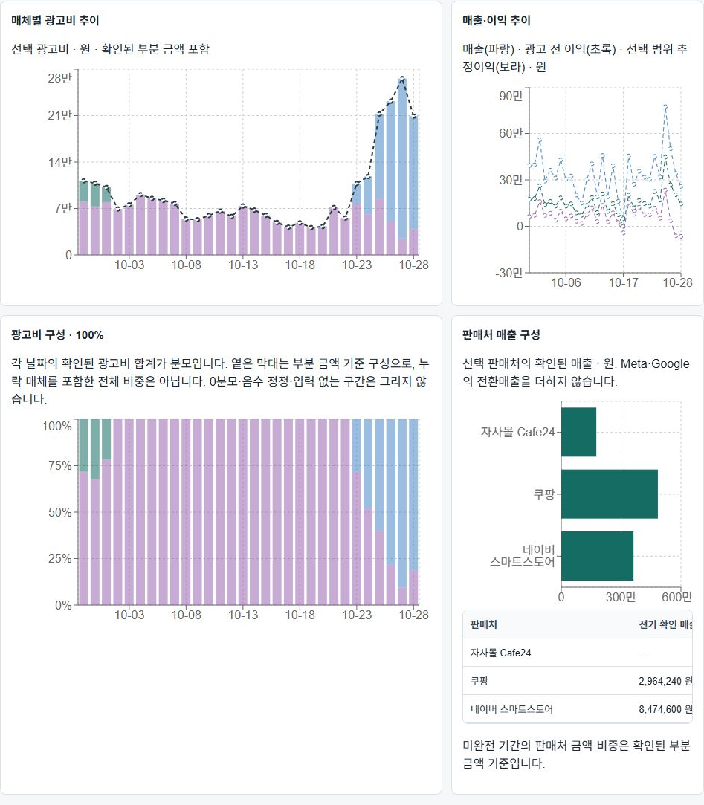

# 11 후속: 동일명 전체 제품 연결

2026-10-30 KST. **DONE: 운영 설정·전체 기간 발행·실제 화면 검증 완료**. 사용자 요청은 기존 플랫폼에서 이름이 같은 제품을 모두 연결하고, 이름이 다른 네이버 항목은 새로 추정하지 않으며 장기간 조회 성능 보완 계획을 작성하는 것이다. 12단계는 시작하지 않는다.

## 적용 범위와 분류 방식

- 기존 풀업바1개에 기존 Meta/Cafe24·쿠팡의 고유 대표 제품·판매단위123개를 추가해 **활성 설정124개**로 만들었다. 현재 Meta/Cafe24 활성23개와 쿠팡의 기존119개 단품·세트 설정을 기존 보호된 canonical 변환으로 대조했다. 숫자는 상품군 수가 아니며 원래의 단품·세트 구분을 유지한다.
- 기존 resolver는 활성 대표 이름과 원천 이름이 정확히 같으면 자동 판정한다. 이 경로를 활성화했으며 동일한 EXACT NAME 규칙123개를 중복 생성하지 않았다. 긴 광고·상품 제목은 아래 실제 원문 대조에 따라 별도46개 규칙을 추가했다. NFC·앞뒤/연속 공백·기존 영문 대소문자 정규화만 사용한다. 내부 띄어쓰기·수량·기호를 지워 다른 이름을 합치지 않는다.
- 이름이 다른 네이버 판매단위37행은 신규 별칭을 추정하지 않았다. 활성96행의 사전 판정은 동일명29 / 기존 부모 이름22 / 기존 승인 별칭8 / 제외37이다. 이 수치는 네이버 판매단위 행 수이며 대표 제품 수가 아니다.
- 쿠팡 `버닝슬라이드`는 Meta `버닝 슬라이드`와 다른 이름이며, 그대로 신규 등록하면 기존 네이버의 승인된 별칭을 가리므로 자동 등록에서 제외했다. 기존 별칭3개와 원천의 부모·판매단위 관계를 보존한다. 미연결 원천 이름과 과거 실적은 삭제하지 않는다.
- 기존 풀업바 NAME v3 / Cafe24 SALE_UNIT v1의 ID·버전·payload·플랫폼·scope·유효기간을 유지했다. 신규 판매단위/가격/원가/환율 설정 변경0, 원천 DML0, 수집·예약·공유 권한 변경0이다.

등록은 실제 `UnifiedManagementService.saveProduct`의 동시성 잠금·감사 기록을 통했다. 124×5플랫폼 **620개 실제 resolver 판정**과 제외37행의 비강제 연결을 확인했다. `research/11-products-preview.json`, `11-products-apply.json`.

## 실제 광고·상품 제목의 연결

목록 이름만 등록하면 `러닝조끼_영상광고…` 같은 긴 원문은 정확 일치하지 않는다. 실제 Meta 광고세트·Google 캠페인·Cafe24 상품 제목376종을 읽기 전용 대조하고, 관측된 명확한 이름에만 **Meta21 / Google6 / Cafe24 19 = 신규46개 NAME 규칙**을 추가했다. 쿠팡·네이버에는 새 포함어/별칭 규칙을 추가하지 않았다.

45개는 실제 제목에 기존 이름이 포함되는 조건이며, 더 구체적인 기존 이름을 제외어로 두어 단품·세트·조합 이름을 넓은 이름에 합치지 않는다. 기존 풀업바 판정도 제외어로 보호한다. Meta의 이미 승인된 이름 별칭은 그 플랫폼 범위에서만 재사용한다.

나머지1개는 자사몰의 두 제목이 `[인피니티 러닝조끼]`를 주상품으로, `러닝양말 무료 증정`을 사은품으로 명시하는 경우다. **관측한 원문 전체2종의 EXACT 조건 / `product_name` 필드 / CAFE24 범위**로만 러닝조끼에 연결했다. 일반적인 두 제품 조합을 임의로 합치지 않는다.

- 기존에 분류되던 원문25종 유지, 명확한 제목294종과 주상품 확정 제목2종 추가: 최종321종 판정.
- 제품명이 없거나 다른 이름으로 쓰인55종은 미분류로 유지한다. 구체적 원문과 판정은 `research/11-products-final-plan.json`의 `rawNameDecisions`에 남겼다.
- 실제 원문의 최초·마지막 날짜752건, 대표 이름620건, 쿠팡119/네이버96행의 두 날짜430건 판정 불변을 확인했다. `research/11-products-final-review.json`.
- 실제 `previewRule/saveRule`의 중복 방지·버전·감사를 사용했다. 기존2규칙+신규46개=48규칙이며 가격·원가·판매단위 변경은0이다.

## 과거 재집계

원천 데이터가 있는 날짜806개와 기존 발행만 있는24개를 합쳤다. **2026-02-26~10-29, 830개 원천·계정·하루**를 최대31일의46개 요청으로 표준 rebuild/worker에 넣었다. 제품마다 같은 날짜를 반복 집계하지 않는다.

최종 서명 계획은 `research/11-products-final-plan.json`, LF 정규화 SHA256 **`68f5a3a6d356b7a4b5ea7b9d9ef55cc42b8753201a0469723b3d19107ddf700f`**다. `11-products-plan.json`은 정확 이름 등록 시점, `11-products-names-plan.json`은 주상품 전체 일치 조건 확정 전의 중간 기록이다. 현재 발행은 최종 계획만 기준으로 확인한다.

| 플랫폼 | 대상 구간 |
| --- | ---: |
| Cafe24 API/기존 CSV | 163 |
| 쿠팡 | 121 |
| Google | 9 |
| Meta API/기존 CSV | 151 |
| 네이버 두 스토어 | 386 |
| 합계 | 830 |

가구매·네이버 배송/이익 일별 요약·광고 업로드 일자까지 추가로1099개 component/day 항목을 읽기 전용 대조했고 계획 밖 누락은0이다. `research/11-products-extra-source-days.json`, `11-products-extra-days-check.json`.

표준 worker의 날짜별 READ ONLY 스냅샷·이름/원가 유효기간·원천/보고서 검산·원자 발행을 그대로 사용했다. report/worker 분리 역할과 비소유자·비super·비bypass 경계를 확인했다. source/default5초, report snapshot20초, 연결 report3/worker2를 늘리지 않았다.

일부 source 읽기의 P2028은 실패 이력을 남기고 해당 날짜만 새 요청으로 재시도했다. 타임아웃이 확인된 건에만 날짜당 최대2회 재시도하며 다른 오류는 멈춘다. 두 날짜 worker는 기존 연결 한도 안에서 부분 범위를 처리하고, 재시도 manifest는 파일 잠금·원자 교체로 갱신한다. 최종 계획의 source timeout4건은 새 요청으로 복구했다. 마지막 부분 범위가 겹쳤을 때 표준 lease가 중복 실행을 막았으며, 다른 worker 완료 후25개 이미 발행 작업의 재확인으로 새 claim/중복 발행0을 확인했다. 원본 FAILED run을 삭제하거나 성공으로 바꾸지 않는다.

중간45규칙 계획의 미완료459작업은 최종 조건 확정 후 표준 claim/fail로 `CONFIGURATION_SUPERSEDED` 종료했다. 유효한 실행 lease를 빼앗지 않고, 만료된 lease는 표준 재claim을 사용했다. 원천·금액 재조회나 기존 발행 삭제 없이 오래된 대기 작업만 종료한 것이며 일반 source 실패와 구분한다. `research/11-products-final-retire.json`.

## 검증과 현재 한계

| 항목 | 상태 |
| --- | --- |
| TypeScript 의미 검사 | 오류0 |
| 제품 등록·원가/기존 규칙 보존 | PASS; 신규123개, 활성124개 |
| 실제 resolver / 제외 검증 | 620 / 37 PASS |
| 실제 원문 날짜 / 쿠팡·네이버 판정 보존 | 752 / 430 PASS |
| 기타 원천 일자 대조 | 1099건, 계획 밖 누락0 |
| 최종830 PUBLISHED·현재 포인터 | 830 / 830 일치, STAGING0 |
| 전체 이력 | PUBLISHED2627 / FAILED475: 중간 설정 종료459, source 실행 실패 이력16. 현재 발행 대상의 실패0 |
| 설정·감사 | 활성124, 규칙48, audit174 |
| 풀업바 기존 확인 금액 / 광고비 | 변경0. 아래 미확정 금액의 신규 확인과 구별 |
| 실제 로그인 화면 | 러닝조끼 30일 광고30점 / 매출·이익90점 / 판매처3막대, 설정 버전 불일치0 |
| 최종 정확 readiness | HTTP200 / PASS / 운영 SHA44cd2a54ccbb351c92d3ece9fd6722481a80ae66 |

근거: `research/11-products-final-inspect.json`, `11-products-final-database.json`, `11-products-final-validation.json`, `11-products-ui.json`, `11-app-products-final.json`. 기존 API304·웹111·guard10은 앞선 앱 코드 배포의 검증이다. 이번에는 앱 코드를 바꾸지 않았으며 운영 스크립트 의미 검사·실제 이름 판정·제한 역할 집계·DB·화면 대조를 새로 실행했다.

### 금액 대조: 2026-09-29~10-28 / 전체5플랫폼

| 제품 | 확인 매출 | 확인 광고비 | 확인 광고 전 이익 | 확인 추정이익 |
| --- | ---: | ---: | ---: | ---: |
| 풀업바 | 182756631.000000 | 70836977.449395 | 105772150.787636 | 34935173.338241 |
| 러닝조끼 | 10220830.000000 | 2790238.426000 | 4827221.640000 | 2036983.214000 |
| 자이로볼 | 38826860.000000 | 0.000000 | 7972699.000000 | 7972699.000000 |

이 값은 **확인된 부분 금액**이다. 미수집·미확정 입력 때문에 완전 합계는 여전히 null이다. 자이로볼 광고비0은 이번에 이름이 판정된 Meta의 실제0 입력이며 다른 매체의 null까지0이라고 확정한 것이 아니다.

러닝조끼는 자사몰1757190 / 쿠팡4842200 / 네이버3621440원의 확인 매출과 Meta807853.426원의 광고비를 실제로 연결했다. 자사몰 사은품 제목도 이제 반영된다.

풀업바 총 확인 매출은 앞선180869480원에서1887151원 증가했다. **기존 확인 금액을 바꾼 것이 아니다.** 같은3609개 자사몰 원천 행에서 ID 추가/삭제0·원천 payload 해시 변경0·제품 귀속 변경0·기존 확인 매출/이익 변경0을 확인했다. 다른 상품의 이름과 주문 계산 입력이 채워지면서 종전 미확정54행의 매출1887151원, 53행의 광고 전 이익1124429원이 새로 확인됐다. 광고비·매체별 금액은 완전히 같다. `research/11-products-pullup-delta.json`.

현재124개 설정 중120개는 발행된 해당 이름 fact가 있다. `리프팅밴드`, `삼대장`, `소프트물병`, `히트체인지 2개입` 4개는 해당 이름의 현재 발행 fact가 없으며 임의0을 생성하지 않았다. 제품명·날짜별 실제 발행 범위는 `research/11-products-final-date-coverage.json`을 따른다.

등록은 날짜를10/28에 고정하지 않는다. 보유한 모든 과거 대상 날짜에 새 설정을 재적용한다. 원천 자체가 없는 플랫폼·날짜, 원가 미확정·추정·미분류는 기존처럼 부분합/null과 진단으로 남긴다.

장기간 **전체 제품 미지정 조회의 P2028·반복 frame 로드 문제는 해결됐다고 판정하지 않는다.** 요청대로 [장기간 조회 성능 보완 계획](../장기간조회_성능보완계획.md)을 작성했다. metadata 전용 옵션, 좁은 projection·DB 집계, 고정 스냅샷 재사용·실제 DB 페이지, 화면 우선순위와 p95/정확성/권한/배포·복구 기준을 정했다. 이번에는 해당 앱 개선·인덱스·요금제 변경을 실행하지 않았다.

## 운영·복구·Git

운영 release는 `codex/product-performance-stage11-history-options-release` / `44cd2a54ccbb351c92d3ece9fd6722481a80ae66`, 배포 `45c56fc3-7fe2-45b4-a1ff-b735ad3d3504` SUCCESS를 유지한다. 설정·집계 데이터에 즉시 반영하므로 이번 앱 배포는 없다. 개발 브랜치의 작업·기록만 커밋·푸시한다.

원복이 필요하면 신규46개 이름 규칙을 먼저, 신규123개 제품 설정을 그다음 현재 버전의 감사 경로로 비활성화하고 영향 구간을 표준 rebuild로 다시 발행한다. 기존 풀업바 설정·규칙·과거 run·원천을 삭제하지 않는다. 기존 결과가 있는 구간은 새 실행이 실패하면 마지막 정상 포인터를 유지한다. 자세한 배포/복구 경계는 `10_배포복구계획.md`를 따른다.

시작 Git: `codex/product-performance-stage11`, HEAD `2169b9cb8e04485d178aba7aa72b504771dd2da0`, upstream `origin/codex/product-performance-stage11`, 시작 변경 없음. 종료 Git은 최종 보고에 실제 SHA·원격 ref·미커밋 범위를 기록한다.

## 네이버 신규 연결 제외 이름

아래37개는 기존 원천 이름 그대로이며 신규 대표 이름으로 임의 통합하지 않았다. 단품·세트·조합 차이도 유지한다.

- 다이어트 양말
- 러닝깔창 데일리 1+1
- 러닝깔창 데일리 단품
- 러닝깔창 PORON 1+1
- 러닝깔창 PORON 단품
- 러닝장갑 1+1
- 무릎키퍼
- 발목보호대 데일리
- 발목보호대 싸커
- 베놈 무릎보호대
- 베놈 무릎보호대 1+1
- 베놈 무릎보호대 단품
- 베놈 무릎보호대(여성용) 1+1
- 베놈 무릎보호대(여성용) 단품
- 손목보호대 기본형 1+1
- 손목보호대 기본형 단품
- 손목보호대 프로 1+1
- 손목보호대 프로 단품
- 스카이깔창
- 스텝마스터
- 스토어 전체 광고
- 스포츠 양말
- 식별 불가능
- 실리콘리프팅+페이스롤러
- 실리콘리프팅1+1
- 카프슬리브 1+1
- 퍼펙트 스케이트
- 퍼펙트스케이트+퍼펙트슬라이드2
- 퍼펙트슬라이드2
- 페이스 롤러
- 페이스 롤러 1+1
- 페이스 롤러 2+1
- 페이스 롤러 단품
- 푸쉬업바
- 히트체인지 넥워머
- 히트체인지 넥워머 1+1
- 히트체인지 넥워머 단품
